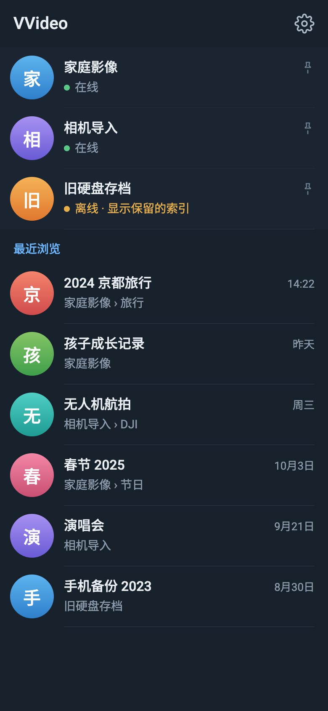
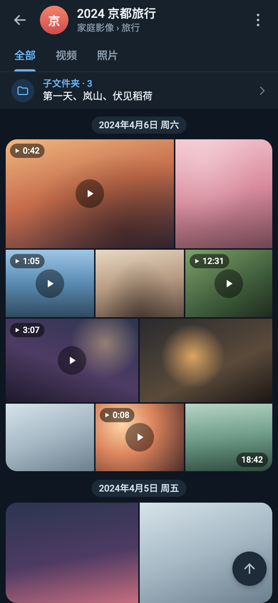
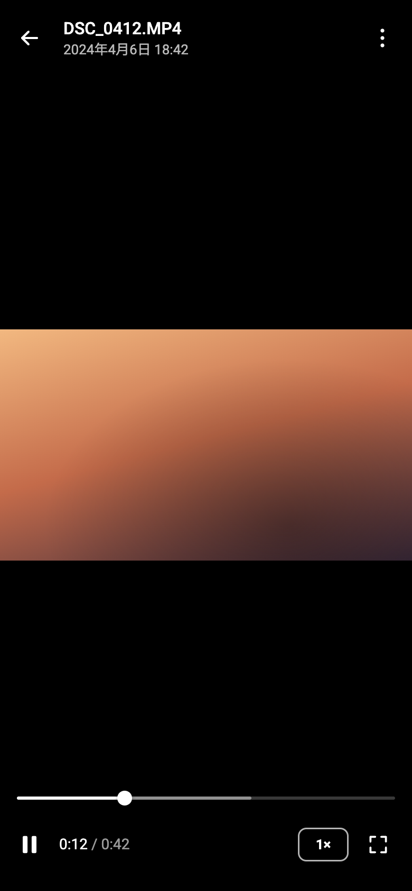

<p align="center"></p>

<h1 align="center">VVideo</h1>

<p align="center">
  自托管的 Linux/NAS 媒体服务，配合原生安卓应用浏览和播放按文件夹整理的照片与视频库。
</p>

<p align="center">
  <a href="README.md">English</a> | 简体中文
</p>

---

VVideo 在媒体库原有位置建立索引。Go 服务扫描文件夹、提取元信息和封面，通过 HTTP 提供原始字节；Kotlin/Jetpack Compose 应用把每个文件夹显示为相册流，全屏播放视频并上下滑动切换。原文件只读：不转码，不改名，也不移动文件。

<p align="center">
  
  
  
</p>
<p align="center"><sub>以上为使用占位图的设计效果图，全部效果图见 <a href="docs/assets/mockups/">docs/assets/mockups</a>。</sub></p>

## 项目状态

**首个版本，验收尚未全部完成。** 服务端和应用已实现，并在合成媒体和真机（iQOO 12 Pro）上测试。尚未验证：NAS 上的完整真实媒体库、全部编码与容器组合、持久化的正式部署。最近一次暖缓存滚动帧测量未达到 1% 超时帧目标。[验收记录](docs/ACCEPTANCE.md)列出测量内容、对应构建和已知限制。

本版范围：仅限家庭内网、原画播放、仅安卓。不在本版范围：公网服务、转码、iOS 和推荐。

## 功能

**服务端（Go，Linux/NAS）**

- 对大型目录树做流式、分批扫描。扫描失败或目录离线时保留原有索引；文件只有在连续两次完整、健康的扫描中都不存在时才视为删除。
- SQLite WAL 模式，一个写连接、四个只读连接；数据库放本机磁盘，媒体可以位于网络挂载盘。
- 持久化后台任务：`ffprobe` 元信息探测，每个视频生成一张 WebP 封面；并发受限，封面缓存按磁盘预算做 LRU 淘汰。播放期间扫描、探测和抽帧照常进行，由各自的并发数限制。
- 按拍摄时间、修改时间或文件名全局排序，游标分页并带稳定锚点，客户端可以恢复到大目录深处的位置。按名称搜索覆盖整个子目录树，结果数量有上限。
- Bearer 令牌鉴权的 API，支持 HTTP Range、ETag 和逐版本校验，客户端不会混用同一文件新旧版本的字节。可选的 MP4 索引提示让客户端按原始偏移预取 `moov`。
- 定时扫描（cron）、严格的配置校验、结构化日志和优雅退出。

**安卓应用（Kotlin、Compose、Media3）**

- 文件夹浏览，每十个媒体组成一块相册，排版与 Telegram 频道相册相同（移植自 Telegram for Android）；各文件夹的排序和浏览位置在重启应用后保留。
- 文件夹页顶部的搜索框可按名称搜索当前文件夹及其全部子文件夹。
- 竖向视频流复用同一个 Media3 播放器，带版本化字节缓存，并有限量、可取消地预加载下一个视频。
- 全屏查看照片，支持缩放和左右翻页；媒体详情显示排序时间的来源。
- 媒体缓存上限可选 1、5、10 GB（十进制），与内存缓冲分开计算。清理缓存不会删除设置和浏览位置。
- 浅色与深色主题、高刷新率滚动，以及播放手势：双击快进快退、长按 2 倍速，在屏幕左侧或右侧边缘上下滑动调节亮度或音量。

设计时参考的库规模（约 13 万视频、38 万图片）是所有者的估计，不是实际统计。规模测试使用 51 万行的合成数据库，与真实媒体的索引是两回事。

## 架构

```text
安卓应用 ──HTTP（Bearer 令牌）──▶ Go 服务 ──▶ SQLite（索引、任务）
  Compose 界面                      │  扫描器 ─▶ 只读媒体目录
  Media3 播放器 ◀── Range 字节 ─────┤  ffprobe / FFmpeg ─▶ 封面缓存
  磁盘缓存（1/5/10 GB）             └  REST API /v1
```

产品行为与性能目标见 [docs/DESIGN.md](docs/DESIGN.md)，服务端扫描、存储与性能规则见 [docs/IMPLEMENTATION.md](docs/IMPLEMENTATION.md)。

## 目录结构

```text
.
├── cmd/vvideo/         服务入口（参数、日志、启动与退出）
├── internal/           服务端各包
│   ├── app/            装配存储、后台任务和 HTTP API
│   ├── config/         严格的配置加载
│   ├── jobs/           持久任务队列与播放活动跟踪
│   ├── library/        已发布索引：目录、媒体、分页、相册锚点
│   ├── mediafs/        基于目录描述符的只读文件访问与挂载身份
│   ├── probe/          ffprobe 与 EXIF 元信息
│   ├── scanner/        两遍观测目录并发布结果
│   ├── storage/        SQLite 独占、连接与 schema
│   ├── streaming/      Range 响应与 MP4 索引提示
│   └── thumbnail/      封面生成与 LRU 缓存
├── tests/              Go 跨包集成测试
├── configs/            配置示例（本地配置被 Git 忽略）
├── deploy/             systemd 服务定义
├── scripts/            真机测量与合成媒体工具
├── android/            安卓 Gradle 工程（:app、:core:media、:benchmark）
└── docs/               设计、API、部署、决策、计划与验收记录
```

目录规则见 [目录规范.md](目录规范.md)（Go）、[安卓目录规范.md](安卓目录规范.md)（安卓）和[项目目录决策](docs/decisions/2026-10-08-project-layout.md)；目录例外统一记录在该决策中。

## 快速开始

### 环境要求

| 组件 | 版本 |
| --- | --- |
| Go | **1.27.1** 或更高，以 [go.mod](go.mod) 为准 |
| FFmpeg | `PATH` 中有 `ffmpeg` 和 `ffprobe`；`ffmpeg` 必须带 `libwebp` 编码器 |
| JDK（安卓） | 21 |
| Android SDK | Platform 36、Build-Tools 35.0.0；设备需 Android 9（API 28）及以上 |

用 `ffmpeg -hide_banner -encoders | grep libwebp` 检查 FFmpeg。Debian/Ubuntu 的 `ffmpeg` 软件包带有该编码器，当前 Homebrew 的 `ffmpeg` 没有。

### 运行服务端

```sh
go mod download
go build -trimpath -o bin/vvideo ./cmd/vvideo
cp configs/config.example.yaml configs/config.local.yaml
# 修改媒体路径，并设置私密、非空的 auth.token
chmod 600 configs/config.local.yaml
bin/vvideo --config configs/config.local.yaml
```

SQLite 数据目录放在服务器本机磁盘，不要放在 SMB/NFS 上；媒体目录可以是网络挂载。发布构建可用 `-ldflags "-X main.version=v1.0.0"` 写入版本号，否则 `--version` 显示 Go 根据 Git 推导的版本。

```text
Usage:
  vvideo [options]

Options:
  -c, --config <file>   Configuration file (default: ./configs/config.local.yaml)
  -v, --version         Print version information and exit
  -h, --help            Print this help and exit
```

退出码：成功、`--help` 或 `--version` 为 0；命令行错误为 2；服务无法启动或运行失败为 1。启动失败时记录一条 `service_failed` 事件并写明原因，例如缺少 `ffmpeg`/`ffprobe`、FFmpeg 不带 `libwebp`、配置文件及出错行、数据库已被另一进程锁定、端口已被占用。收到 SIGTERM 后取消后台工作，最多等待 30 秒让 HTTP 请求结束。

### 构建并安装安卓应用

Gradle Wrapper 固定 Gradle 8.14.3；AGP 8.13.2、Kotlin 2.2.21、Media3 1.8.1 等依赖固定在 [android/gradle/libs.versions.toml](android/gradle/libs.versions.toml)。请设置 `ANDROID_HOME` 或被 Git 忽略的 `android/local.properties`。

```sh
android/gradlew -p android :app:assembleDebug
adb install -r android/app/build/outputs/apk/debug/app-debug.apk
```

在应用设置中填写服务根地址（例如 `http://192.168.1.10:8080`）和令牌。任意主机都可以使用 HTTP 或 HTTPS。HTTP 不加密连接，同一网络中的任何人都能读到令牌和媒体内容。

构建变体、真机测试和性能测量见 [android/README.md](android/README.md)。

## 配置

[configs/config.example.yaml](configs/config.example.yaml) 列出全部支持的字段。只有 `auth.token` 和至少一个 `media[].path` 是必填项，其余都有默认值。配置只在启动时读取，修改后需要重启。

**选择配置文件。** `-c`/`--config`（也可写 `--config=<file>`，以最后一个为准）优先于 `CONFIG_FILE`，后者优先于工作目录下的 `configs/config.local.yaml`。相对路径以工作目录为基准。显式指定的文件为空、不存在、不可读或格式错误时报错；只有隐式默认文件允许不存在，此时必须由环境变量提供必填项。

**优先级与环境变量。** `VVIDEO_*` 环境变量覆盖 YAML 文件，YAML 覆盖默认值。变量名为 `VVIDEO_` 加大写字段路径，层级之间用 `__` 连接，例如 `VVIDEO_AUTH__TOKEN`、`VVIDEO_CACHE__PATH`。`VVIDEO_MEDIA` 和 `VVIDEO_IGNORE` 用 `{"path": "..."}` 对象组成的 JSON 数组替换整个列表。未知或旧字段、重复键、YAML 别名和标签、类型错误、必填项为空都会被拒绝。不加载 `.env`，YAML 中也不做变量替换。

| 配置项 | 含义 | 默认值 |
| --- | --- | --- |
| `server.listen` | 主机名或 IP 地址，不含端口；IPv6 写作 `::` | `0.0.0.0` |
| `server.port` | TCP 端口，1–65535 | `8080` |
| `auth.token` | 客户端必须携带的 Bearer 令牌 | 必填 |
| `storage` | 数据目录，内含 `data.sqlite` 和扫描暂存区 `.scan-tmp/` | `data` |
| `media[].path` | 媒体根目录，彼此不能重叠 | 必填 |
| `ignore[].path` | 媒体根内要排除的具体文件或目录子树，不支持通配符 | 无 |
| `scan.cron` | 五段式 cron，可加 `CRON_TZ=` 前缀；留空则关闭定时扫描（启动时仍扫描一次） | `*/30 * * * *` |
| `scan.parallel` | 扫描时并发读取文件属性的数量 | `2` |
| `scan.probe_parallel` | 同时运行的 `ffprobe` 任务数 | `2` |
| `cache.path` | 封面缓存目录 | `cache` |
| `cache.max_size` | 封面缓存上限，单位 `MB`、`GB`、`MiB` 或 `GiB` | `30GB` |
| `cache.parallel` / `cache.threads` | 同时运行的抽帧任务数 / 单个任务的解码线程数 | `2` / `2` |
| `cache.percent` | 封面取自视频时长的百分比位置，范围 `[0, 100)` | `10` |
| `log.level` / `log.format` | `debug`、`info`、`warn` 或 `error` / `json` 或 `text` | `info` / `json` |
| `log.output` / `log.file` | `stdout`、`stderr` 或 `file`；仅当为 `file` 时必须且只能填写 `log.file` | `stdout` |

YAML 中的路径以配置文件所在目录为基准；环境变量和默认值中的路径以工作目录为基准。可写目录（`storage`、`cache.path`、`log.file`）必须位于媒体根之外。并发类数值可取 1–1024，它们限制的是 VVideo 自己的工作者，不是进程线程总数。日志文件只追加、不轮转，请用 logrotate 的 `copytruncate`。生成封面期间，每 5 分钟输出一条 `thumbnail_progress` 事件，报告进度、速度和预计剩余时间；队列空闲时不输出。

媒体库的 ID 在重启和调整顺序后保持不变。修改根目录路径会产生新的媒体库；移除根目录只停止管理，不会动文件。超时、重试次数、分页大小等资源策略内置于程序，见[设计文档](docs/DESIGN.md)和 [HTTP API](docs/API.md)。

## 部署

[deploy/vvideo.service](deploy/vvideo.service) 是一个加固的 systemd 服务定义，假设程序位于 `/opt/vvideo`，以 `vvideo` 服务账户运行。安装前：

1. 创建该账户和可写的 `/opt/vvideo/data`、`/opt/vvideo/cache` 目录，安装程序和 `configs/config.local.yaml`。
2. 按你的系统调整路径和账户。该服务只允许写 `data/` 和 `cache/`；如果使用 `log.output: file`，请把日志目录加入 `ReadWritePaths`（或保留默认的 stdout，由 journald 收集）。保留对媒体挂载点的读取权限。
3. 安装为 `/etc/systemd/system/vvideo.service`，然后执行 `systemctl daemon-reload` 和 `systemctl enable --now vvideo`。

尽量以只读方式挂载媒体。服务只写自己的数据目录和封面缓存；锁文件会阻止第二个进程打开同一个数据库。

**备份与状态。** 请备份私有配置，以及 `data/data.sqlite` 的一致快照（先停止服务，或使用 SQLite 在线备份）。封面缓存和扫描暂存区可以重建。首个稳定版本之前不提供 schema 迁移：如果新版本提示 schema 版本不匹配，请停止服务、删除数据目录，让程序重新建立索引。媒体文件不受影响。

## 开发

```sh
gofmt -l . && go vet ./...
go test ./...
android/gradlew -p android :app:testDebugUnitTest :core:media:testDebugUnitTest :app:lintDebug :core:media:lintDebug
```

`scripts/generate-media.py <目录>` 生成一个小型合成媒体库（MP4、MKV、TS、MOV 容器中的 H.264、HEVC、AV1 视频，以及照片），用于本地测试。不要提交真实媒体、令牌或服务器地址。

工作流程、代码风格和提交 PR 前需要通过的检查见[贡献指南](docs/CONTRIBUTING.md)。使用 AI 代理参与开发时，还需遵守 [AGENTS.md](AGENTS.md)。

## 文档

| 文档 | 内容 |
| --- | --- |
| [docs/DESIGN.md](docs/DESIGN.md) | 产品行为与性能目标 |
| [docs/IMPLEMENTATION.md](docs/IMPLEMENTATION.md) | 服务端扫描、存储与性能规则 PERF-01 至 PERF-12 |
| [docs/API.md](docs/API.md) | HTTP API 与错误码 |
| [docs/DEPLOYMENT.md](docs/DEPLOYMENT.md) | 测试机部署记录 |
| [docs/ACCEPTANCE.md](docs/ACCEPTANCE.md) | 测量与验证结果及限制 |
| [docs/decisions/](docs/decisions/) 与 [docs/plans/](docs/plans/) | 设计决策与实施计划 |
| [android/README.md](android/README.md) | 安卓构建变体、真机测试与测量（英文） |

## 安全

API 面向可信的家庭内网设计。请使用足够长的随机令牌，把监听地址和防火墙限制在局域网内；网络不可信时请使用 HTTPS（例如放在反向代理之后）。报告安全漏洞请按 [docs/SECURITY.md](docs/SECURITY.md) 操作，不要公开提交 issue。

## 许可证

Copyright 2026 jzx。依据 [GNU 通用公共许可证 v3.0 或更高版本](LICENSE) 授权。

安卓相册排版移植自 [Telegram for Android](https://github.com/DrKLO/Telegram)（GPL-2.0 或更高版本），详见 [NOTICE](NOTICE)。VVideo 与 Telegram 没有关联。
