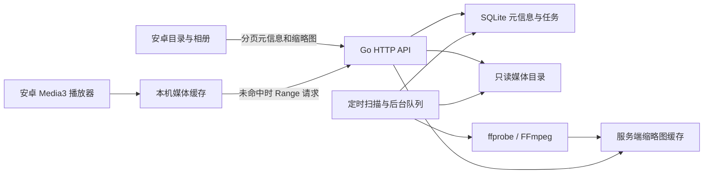

# VVideo：媒体库与安卓播放设计

日期：2026-10-08（Asia/Shanghai）

状态：产品行为与验收目标的单一来源。2026-10-09 首版 Go / Android 代码及记录条件内的真机验收已完成，真实完整媒体库与实际媒体挂载盘场景仍待验证，实际结果与限制见 [验证记录](ACCEPTANCE.md)。本文中的参数仍是设计规则与门槛，不能直接视为实测结论。

施工入口：[AGENTS.md](../AGENTS.md)、[Go 目录基线](../目录规范.md)、[安卓目录规范](../安卓目录规范.md)、[项目目录决策](decisions/2026-10-08-project-layout.md)。目录与模块归属按这些规范执行，产品行为与性能目标以本文为准。

## 已确认需求

- C/S 架构，服务端使用 Go，部署于 Linux / NAS，媒体位于本机磁盘或挂载盘。
- 用户估计约 13 万视频、38 万图片；沿用已有目录分类。
- 第一阶段仅内网、原画播放，不加入转码。
- 首先支持 Android，目标验收设备为用户的 iQOO 12 Pro；iOS 待后续决定。
- 目录中每 10 个媒体组成一块拼接相册，根据横竖比例排列，视频显示时长。
- 目录右上角提供类似 Telegram 的“⋮”菜单。默认按拍摄/录制时间最早在前排列，支持切换排序，并记住各目录的选择。
- 安卓持久保存上次打开的目录及各目录浏览位置，退出 App 后再次打开仍能恢复到原媒体附近；此记录不随媒体缓存清理而删除。
- 点击视频进入全屏播放，上下滑动切换当前目录的视频，播放队列跨越相册分组。2026-10-20 用户要求：全屏播放时在屏幕左、右各约 1/5 宽的边缘条带内上下滑动，分别调节亮度和音量；中间区域仍上下滑动切换视频，竖屏和横屏相同。
- 2026-10-20 用户要求：文件夹页顶部提供搜索框，按名称搜索当前文件夹及其全部子文件夹中的文件夹与媒体。
- 点击图片进入全屏查看，左右滑动切换当前目录的图片（图片与视频各自成队列；视频仍上下翻页）；放大后单指拖动平移图片，不翻页。
- 定时扫描新增、变更、缺失文件；每个视频按配置的时长百分比生成一张封面，不生成额外位置截图；后台工作并发可控。
- 安卓支持视频预加载，媒体磁盘缓存上限可选 1 GB、5 GB、10 GB，并支持清理缓存。
- UI 和性能为交付门槛，以 Telegram 安卓端的跟手感和资源控制为体验参考，尤其关注连续滑动。对标不等于已达到相同水平，必须通过真机测量。
- 相册滚动和全屏翻页支持设备与系统允许的 120 / 144 Hz 等高刷新率，应用不设置固定帧率上限；高刷是第一版要求，不能只用 60 Hz 验收代替。

## 架构与决策

### ADR：安卓原生客户端

建议采用 Kotlin、Jetpack Compose 和 Media3 / ExoPlayer。目录按组懒加载，全屏使用纵向分页交互。相比 Flutter，原生方案可以直接控制 Media3 数据源、预加载、播放画面挂载和安卓性能采集；代价是未来 iOS UI 需要单独实现。后端 API 不依赖客户端平台。

优先使用一个持续复用的前台播放器，配合 Media3 预加载媒体源。避免每个卡片或分页各自建立解码器。若真机测试证明首帧交接不足，再评估严格限制数量的播放器池；不提前增加同时工作的解码器。

### ADR：SQLite 起步

约 51 万条元信息本身不足以判断 SQLite 不适用。建议单实例 Go 服务配合 SQLite WAL、短事务、受控写入、按目录建立索引并采用游标分页。视频和图片原件不存入数据库。

数据库文件部署于运行 Go 服务那台机器的本地文件系统；媒体可在挂载盘。不得将 WAL 数据库直接放在 SMB/NFS 共享上。

MySQL 作为出现多实例或明显写并发瓶颈时的替代方案，迁移前以实际查询和写入测量为依据。第一阶段不引入 Redis；它不能解决磁盘寻道、视频解码和主线程掉帧。

### ADR：原文件 Range 直放

Go 正确处理 Range、206、Content-Range、Content-Length、无效范围和文件版本；安卓直接读取原始文件。基础 Range 播放先验证，索引预缓存作为在同一播放链路上的优化。

普通 MP4 的 moov 可以在尾部，Media3 的 MP4 提取器具备跳过大数据区并读取索引的能力。索引位于尾部不等于必须完整下载或重新封装。

Go 可额外按 MP4 box 结构记录 moov 偏移、长度以及必要初始化范围；MKV/WebM 经 SeekHead 找到 Cues 元素范围；TS 提示末尾 min(文件大小, 112,800) 字节，即 Media3 在轨道就绪前读取时长的范围。安卓在对应原文件缓存键、原字节偏移下预取实际字节；普通时长/分辨率 JSON 不能替代播放器需要解析的索引。限制索引解析大小、box/元素数量和用时；异常文件退回标准读取并显示可诊断错误。

索引缓存键包含服务端库标识、媒体 ID 和文件版本。文件变更使旧范围和媒体源失效；播放请求遇到版本不一致时重新取元信息，不混合新旧字节。

此设计针对普通 MP4；分片 MP4 和其他容器需按各自结构处理。第一阶段不批量改写源文件，也不依靠转码解决不支持的编码。

## 预加载与缓存

### 预加载窗口与优先级

| 相对位置 | 初始策略 |
| --- | --- |
| 当前视频 | 当前播放/拖动请求最高优先级，持续按需缓冲 |
| 下一条 | 优先预取必要索引，再预取开头可播放样本；初始目标约 3 秒，同时设置字节上限 |
| 下两条 | 仅提前获取元信息与封面；有剩余预算时才考虑进一步预取 |
| 上一条 | 保留已经读取的缓存，方便反向滑动，不默认重新整段下载 |
| 更远位置 | 退出活动预加载窗口，解除媒体源引用；已有磁盘数据由淘汰策略管理 |

“3 秒”是初始调优参数，不代表任何码率下都能在相同时间内完成预取。预取还必须受总字节、并发和内存预算约束；最终上限经样本码率和真机测试决定。

优先级随滑动方向和当前页更新。快速连滑时，取消已经越过且不再相关的预取；只让最终选中的页面播放，避免中间多条视频反复 prepare、启动解码或发声。反向滑动同样更新优先级。

预取与播放共用数据源和缓存键，去重相同字节范围。预取不能无限占用当前视频需要的连接、缓存锁或磁盘资源。当前视频出现缓冲不足时暂停或缩减预取。退出播放页、进入后台时取消不必要的预取并管理播放器生命周期。

### 磁盘预算

- 设置提供 1 GB、5 GB、10 GB。本文 GB 采用十进制字节，即 1 GB = 1,000,000,000 字节；建议默认 5 GB，仍属待验证的产品默认值。
- 选择值是可回收媒体内容的磁盘缓存预算，不预先占满空间，更不是播放器的 RAM 配额。
- 缓存页分别显示视频、图片/缩略图的占用与合计。由应用协调两类缓存的预算，使它们不会各自重复使用整个上限；缓存索引等小量管理开销单独统计。
- 满额时优先淘汰最近最少使用的数据；播放可以只缓存读取过的片段，无需等整段视频下载完。
- 检查手机可用空间，低存储时停止预取、回收旧内容并提示实际限制。即使选择 10 GB，也不保证手机当时有 10 GB 可用空间。
- 用户调小上限时，暂停新增预取并在后台回收超额内容。若媒体缓存实现需要重建实例，等播放数据源安全关闭后执行，不能在读取期间直接替换缓存对象。
- 视频媒体缓存以应用级单例管理；同一目录不并存多个 SimpleCache 实例。
- 持久缓存是可丢弃数据，不承诺完整离线播放；库配置、历史记录和用户设置不属于“清理缓存”的内容。

### 清理缓存

设置提供“清理媒体缓存”，显示当前占用、执行状态和执行结果。先停止预取及缓存写入，关闭使用中的数据源，再通过缓存 API 清理并重建所需实例；清理过程放在后台线程。若正在播放，需要明确暂停后清理，避免悄悄删掉活动缓存文件。

清理视频缓存时同时清理对应缓存索引，不直接删除正在使用的缓存目录。清理只影响手机媒体缓存，不删除 NAS 原件、库配置或播放历史。磁盘清理与内存释放分别处理，不能只刷新界面上的数字。

### 内存预算

播放缓冲、预加载样本缓冲、图片解码缓存分别设定预算。图片按实际显示尺寸解码；列表使用缩略图，不将 38 万张原图或整份目录列表装进内存。10 GB 磁盘配额不改变内存预算。

## UI 与流畅度

- 相册按 10 个媒体一组，最后一组允许不足 10 个。2026-10-20 按用户要求，拼图排版移植 Telegram for Android 频道相册（`MessageObject.GroupedMessages.calculate()` 与 `ChatMessageCell` 的尺寸规则，GPL-2.0 或更高版本；项目随之改为 GPL-3.0-or-later，见根目录 NOTICE）：2–4 项用固定版式（含一大带几小的跨行格），5 项及以上把宽高比压到 0.67–1.7 后在 2–4 行、每行最多 3 项的分法中选总高度最接近 4/3 宽度者；格宽按屏宽、格高按半屏高换算后整体缩放到相册宽度，封面居中裁切；外角 15dp、内角 4dp、格缝 2dp。首页、文件夹、深浅蓝主题与控件视觉见 [安卓 UI 重设计规范](plans/2026-10-10-android-ui-telegram-style.md)；产品行为、排序、缓存和验收门槛仍以本文为准。
- 分页获取目录元信息；布局只创建可见组和少量邻近组。每组布局结果按媒体版本、宽度与顺序缓存，不在每次滑动帧中重新计算整个目录。
- 在缩略图加载前用已知宽高比预留位置，防止图片到达后布局跳动。旋转信息参与显示宽高比计算。
- 使用稳定媒体 ID 保持定位；从播放器返回时恢复相册滚动位置。新增/删除文件后的列表更新保持可见媒体锚点。
- 从子文件夹返回上一级（或从首页再次进入）时，回到离开时的首个可见行及偏移；本次运行内存中最多记住 64 个文件夹，换排序、切换类型或回到开头时清除该文件夹的记录。只列子文件夹的页面没有媒体锚点，此位置不跨重启保存，且只在重新加载的首页子目录（100 项）内命中，否则回到顶部。子文件夹在相册之前的页面，停在子文件夹行时，本次运行内回到该行；跨重启的书签记为“文件夹开头”，重开时回到顶部并显示子文件夹。
- 全屏页保持原视频比例，横屏视频默认完整显示；封面保持到目标视频真正输出首帧再移除，避免切换露出空白。
- 确保页面、播放声音和目标媒体一致，不出现旧视频画面或声音串到新页。
- 播放器边缘手势：只有起点在左/右边缘条带、且越过触摸阈值后以竖向为主的拖动才调节亮度/音量，并在此后不再交给翻页和点按手势；点按、双击快进快退、长按倍速和横向移动不受影响。向上为增大，拖过屏幕高度的 60% 覆盖 0–100%。亮度只改本窗口（不改系统设置、不需权限），离开播放器恢复系统亮度；音量调节媒体音量。调节时在顶部显示百分比。
- 查看器的点按只认未移动的按压：按下后移动超过触摸阈值的手势不算点按，不切换控件显示；竖滑照片、横滑视频都不会让顶栏或控件消失（2026-10-21 修复）。
- 拖动进度条与双击快进快退均为精确定位（Media3 默认精确 seek），画面落在所拖位置。2026-10-21 用户决定：关键帧稀疏的视频须从前一个关键帧解码到目标位置，拖动后就绪会变慢，接受这一代价并保持现状；不改为按关键帧定位、不加快速拖动开关，此问题之后不再处理。实测样本 `nile-falls.webm`（VP9 1080p、11 秒、仅第 0 秒一个关键帧）拖到 3/4 处 885–906 ms 才就绪，超出编解码矩阵测试的 800 ms 断言；该断言与测试保持不变，这项失败按已知结果记录。
- 文件夹搜索：输入停顿 300 ms 后请求服务端，名称包含查询字符串即匹配（仅 ASCII 字母不区分大小写，中文等按原文匹配），结果先列文件夹、再列媒体，各自按名称排序；最多返回 50 个文件夹和 200 个媒体，超出时提示输入更具体的名称而不分页。点文件夹进入该文件夹，点媒体在其所在文件夹的队列中打开查看器。返回键先结束搜索，打开任何文件夹也会结束搜索；搜索期间不改动该文件夹的浏览位置。
- 网络读取、索引解析、磁盘操作、图片解码、大量列表计算和缓存清理均不阻塞 UI 主线程。播放器生命周期调用遵循其线程约束。

### 目录菜单与排序

- 在目录页顶部栏右上角放置“⋮”溢出菜单，借鉴 Telegram 的入口形态。菜单列出“拍摄/录制时间”“文件修改时间”“文件名”，并可选择升序或降序；显示当前选择。
- 2026-10-20 用户把默认项改为“拍摄/录制时间，最早在前”（此前为最新在前）。已保存“拍摄时间·最新在前”的目录在本机数据库升级时一次性改为新默认并丢弃该目录的旧浏览锚点：旧版本把默认值与主动选择存成同一记录，无法区分。服务端 API 在未传排序参数时仍按最新在前，客户端始终显式传递。排序针对当前目录的完整媒体集合，然后再按十个一组展示；不能只对已经下载到手机的一页排序。
- 拍摄时间来自媒体中可用的原始拍摄字段。例如图片优先使用原始拍摄时间和对应时区信息；视频按实际容器/设备的时间字段映射。容器的 `creation_time` 可能是录制时间，也可能是导出或编辑时间，不能仅凭字段名宣称它就是准确拍摄时间。
- Go 保存时间值与来源。存在明确时区或格式规范明确其 UTC 含义时统一为可比较的时间戳；无时区且无法确定时间含义时保留原值，不作时区推定。缺失、无法解析或已识别为无效的拍摄时间回退文件修改时间；详情注明实际来源。精简配置不提供媒体时区字段，不能偷偷用手机/服务端当前时区、cron 时区或扫描时间补齐。
- 所有客户端使用服务端确定的排序键。相同有效时间以稳定媒体 ID 再排序；排序键、方向与游标契约一致。拍摄时间降序的示例总序为 `(effective_time DESC, media_id DESC)`，避免同秒媒体在翻页时任意交换。
- 本节的媒体排序不把子目录混入十媒体相册。子目录作为独立导航项，沿用明确的名称序；若以后需要对子目录排序，另行定义语义。
- 2026-10-22 用户要求：既有子文件夹又有媒体的文件夹，把子文件夹全部以列表行列在相册之前，点一下直接进入；取消原先的“子文件夹 · N”条和底部面板。子文件夹按 100 个一页随滚动加载，与只有子文件夹的页面相同。服务端每一页都带向前游标，客户端只在不带锚点打开、或向前翻到空页时，才认定已加载的相册从开头开始；只有这时才在相册前显示子文件夹。从书签停在相册深处打开时，子文件夹要等向前翻到开头才出现，不在中途插入。切换“视频/照片”时子文件夹照常显示。
- 排序选择按服务器/媒体库和目录分别持久保存。用户主动切换排序时重新请求首组，明确展示新顺序，并重置该目录的浏览锚点；下次进入则按保存的新顺序与位置恢复，不沿用旧排序的页号或游标。
- 正在浏览或播放时索引更新不应突然打乱已呈现的内容。刷新时以稳定媒体 ID 重定位，目录版本变化使旧游标失效时重新定位，不能拼接不同版本的排序结果。

### 退出后的浏览位置恢复

目标体验：在某目录浏览到中间，退出后从 App 图标重新打开，回到同一目录、同一媒体附近；不必从第一屏手动翻回。恢复目录页默认不自动播放视频。

持久保存最小状态：

| 状态 | 内容与用途 |
| --- | --- |
| 最近浏览入口 | 服务器连接标识、媒体库标识、目录 ID，恢复最后访问的目录 |
| 各目录排序 | 排序字段与方向；与浏览锚点一起使用 |
| 内容锚点 | 可见媒体的稳定 ID、排序键，以及必要的邻近媒体 ID，避免只保存列表序号或滚动百分比 |
| 布局位置 | 锚点媒体相对视口的位置、组内位置和用于判断是否可复用的布局尺寸信息 |
| 保存版本 | 状态格式版本、保存时间与目录数据版本，用于校验和迁移 |

- 最近入口等少量偏好由 DataStore 保存；按目录增长的浏览记录由 `data/library/local/` 的持久存储管理，优先采用 Room。它们是浏览记录，不是可回收视频或缩略图缓存。
- 滚动过程中节流保存最新稳定锚点，停止滚动、切换目录、离开页面时补充保存。使用后台 I/O，避免每个动画帧写盘；不能只在 `onDestroy` 或退出按钮中保存。
- `rememberSaveable` / `SavedStateHandle` 用于 Activity 重建的轻量状态协作，不能作为用户退出后冷启动恢复的唯一机制。正常重开恢复已保存位置；意外断电或被立即终止时只能保证最近一次已成功落盘的状态，不承诺最后一帧必然保存。
- 恢复时先取排序与锚点，再让服务端定位锚点附近的分页窗口。服务端返回锚点所在十媒体组及邻近游标，组边界与完整目录排序一致；不能为了恢复到中间而从首页连续拉取所有前置页。
- 在数据和布局可用后直接定位，不播放从顶部滚动到中间的长动画。只有首次恢复时应用锚点，后续数据到达或重组不能反复把用户拖回旧位置。
- 若原媒体已删除，优先定位仍存在的邻近媒体，再按保存的排序键寻找最近位置；找不到时返回目录开头并给出简短说明。宽度、方向或相册布局改变时优先保住目标媒体，重新计算偏移，不强行复用旧像素值。
- 目录确已删除时回到可用父目录或媒体库入口并提示。NAS 离线、鉴权失败或暂时读取失败时保留原书签，不能用“空目录/首页”覆盖它。
- 从全屏播放器返回时恢复进入播放前的相册位置；全屏视频当前项与相册锚点分开管理，避免上下切换视频意外覆盖相册浏览记录。跨重启恢复视频播放进度不是本次新增要求，需按后续播放历史需求单独定义。
- 清理媒体缓存不删除排序选择、最近目录或浏览记录。卸载或通过系统清除 App 数据不在此保留保证内；第一版不承诺跨设备同步浏览位置。

## 服务端性能与失败处理

2026-10-09 对用户提供的参考项目完成源码提取，证据与未采用部分见 [性能决策](decisions/2026-10-09-scan-storage-performance.md)。服务端施工必须遵循 [开发说明中的 PERF 规则](IMPLEMENTATION.md)，按 [服务端性能实施计划](plans/2026-10-09-server-performance.md) 落成测试；已有可执行实现与合成测试，完整 NAS 性能仍待真实库验证。

- 扫描、元信息探测、抽帧和用户播放分开排队。2026-10-20 按用户决定，后台扫描、探测和抽帧不再因播放暂停，靠各自并发上限控制与播放的 I/O 争用；只有列表重排（排序键、相册锚点）仍等播放结束。
- 分页读取目录并限制属性并发，正式 SQLite 单写多读、WAL/FULL，批量事务与查询索引共同优化；文件系统和工具调用不占写事务。初始内部批次为 128，未变媒体不逐条写库、不重复探测。该批次大小不增加 YAML 配置。
- 完整枚举仍有随文件数增长的成本；增量指减少不必要的持久写入及媒体处理，不代表无需遍历。分别计量文件发现、元信息就绪、封面就绪，不能把小文件索引基准当真实媒体建库耗时。
- 扫描比较路径、大小、修改时间和可用的文件身份信息（inode、ctime；不含挂载时分配、重挂会变的设备号），通常只对新增或变更文件探测；这些字段不是内容哈希，特殊的同大小同时间替换需要强制刷新或进一步校验。
- 缩略图按时长百分比计算时间点，百分比、分辨率、质量与媒体版本纳入任务标识。每个视频只生成一张封面；第一版不做多位置截图、进度条缩略图预览或手动挑选封面。
- “并行多少个 FFmpeg 进程”和“每个任务的解码/滤镜线程数”分开配置；同时限制超时和 I/O，单个 threads 参数不是整个进程的严格 CPU 上限。
- 未完成复制或正在写入的文件延后探测；任务持久化、失败可重试且设上限，重启后不必重做全部工作。
- 只有成功完成相应目录/扫描范围后才判断文件缺失。挂载盘断开、权限错误、扫描中断不能视作整库删除；先标记异常或离线，保留原索引。
- 播放 API 使用媒体 ID，在服务端解析到允许的根目录；不能由客户端提交任意文件路径。提供内网访问凭据。

## 服务端 YAML 配置

配置示例位于 [configs/config.example.yaml](../configs/config.example.yaml)，2026-10-09 按用户要求保留有实际调整价值的参数，不追求字段最少。部署位置、扫描时间、CPU/I/O 并发、抽帧百分比和磁盘预算可配置；连接数、超时、重试及其他实现细节内置。保留参数不代表全部必填，可选项有默认值；不保留旧字段或隐藏环境入口。严格加载器已实现；示例仍需填写私有令牌和部署路径。实际命令见两个 README，执行范围见验证记录。

### 加载与校验契约

- 加载路径、优先级和环境映射见两个 README 的“配置约定”；修改后重启生效，不做热重载。非空 `auth.token` 与至少一个非空 `media[].path` 必填；`ignore` 默认空列表，不将示例媒体路径作为内置库。
- 启动参数 `-c` / `--config` 等价，文件选择优先于 `CONFIG_FILE`，重复指定不同文件属于用法错误；相对路径以工作目录为基准。显式空值或无效文件不回退；选定文件中的配置项仍可由 `VVIDEO_*` 环境变量覆盖。`-h` / `--help`、`--version` 输出到 stdout 并以 0 退出（不再提供 `-v`）；未知参数、缺值、位置参数和冲突的配置路径在服务初始化前以 2 退出，错误写 stderr。配置与日志文件错误在日志初始化前以纯文本写 stderr 并以 1 退出。
- 启动错误必须指明原因，不得笼统报“初始化失败”：缺少 `ffmpeg` / `ffprobe`、FFmpeg 缺少 `libwebp` 编码器、配置文件路径与行号/字段/环境变量名、数据库路径及锁冲突、监听端口占用分别报告。FFmpeg 能力在打开数据库前检查，端口在启动后台任务前绑定。配置错误可列出出错的配置路径值以便定位，但从不输出令牌；运行期日志仍不记录媒体文件完整路径。
- 只接收单个 YAML mapping 文档，拒绝重复键、未知字段、类型错误、自定义标签、合并键和别名。已移除的旧字段须报错，不能静默忽略。数据库 schema 版本由内部机制维护，不要求用户填写配置版本；上线前不做迁移，版本不符时提示删除数据目录重建。
- `server.listen` 只填主机名或 IP，不含端口，默认 `0.0.0.0`，IPv6 直接写 `::` 等地址；`server.port` 是 1–65535 的整数，默认 `8080`。`server.listen` 中出现 `host:port` 写法按旧格式报错，并提示改用 `server.port`。
- `storage` 是数据目录路径字符串，SQLite 数据库固定为目录内的 `data.sqlite`，扫描暂存 `.scan-tmp/` 也在该目录内；路径已存在且不是目录时报错。`cache` 是缩略图配置对象，`cache.path` 为目录路径。文件中相对路径以配置文件所在目录为基准；省略路径字段时内置为工作目录下的 `data` 和 `cache`。示例在 `configs/` 内，因此填 `../data` 和 `../cache`，避免把运行数据写入配置目录。缓存根用 `cache/` 而非基线的 `.cache/`，例外见[项目目录决策](decisions/2026-10-08-project-layout.md)。
- `media`、`ignore` 都是仅含 `path` 的对象列表。媒体根不得重复或相互嵌套；数据库、缓存须分离，不得写入媒体树。根内媒体符号链接不跟随，写入路径须检查解析符号链接后的冲突。
- `ignore[].path` 指定文件或整个目录子树，按规范化路径的完整分量匹配，不作通配符或全局同名目录匹配。路径必须在某个媒体根内且不等于根本身；允许目标暂不存在，边界检查不能因不存在或符号链接而失效。新增排除不算删除，取消排除后可重新发现媒体。
- 库 ID 在首次登记时自动生成并持久保存，按规范化根路径关联；重排配置列表、重启或临时离线不能更换 ID。显示名称从目录名生成；改根路径不自动推测为同一库，需明确迁移映射。移除配置项只停止管理，不删除源文件或历史索引。
- 不再要求用户维护标记文件。扫描前后检查 Linux 挂载信息、文件系统身份和访问状态，与持久记录比对；无法确认健康时跳过缺失核对。目录存在或返回空列表不足以证明挂载健康，首次即离线或网络文件系统状态含糊时保守保留记录，不声称可以识别所有 NAS 故障。
- `scan.cron` 为五段式“分 时 日 月 周”，不接受秒/年字段或 `@every` 简写；允许 `CRON_TZ=Asia/Shanghai` 这类 IANA 时区前缀，否则采用服务进程本地时区并在启动日志记录。空字符串只关闭定时触发，启动扫描仍按内置策略执行；语法错误或非法时区报错。日与周同时受限时采用标准 cron 的“或”语义。
- `scan.parallel` 必须为正整数，限制全局文件属性读取工作者数量；首版一个目录遍历协调者，不能每目录再乘一层 worker。它不是 Go 进程系统线程上限，也不直接放大 ffprobe / FFmpeg 并发。
- `scan.probe_parallel` 必须为正整数，默认 2，是同时运行的 ffprobe 元信息探测任务数。抽帧要等探测得到时长才入队，首次建库时它决定封面能跟上的速度；网络挂载上单次探测主要耗在往返延迟，可按存储实测调大。2026-10-20 按用户在 Samba 机械盘环境的实测新增，原内置的 2 个探测工作者改为此默认值。
- `cache.parallel` 是抽帧工作者总上限，`cache.threads` 是每个任务的解码线程期望值，均为正整数且默认 2。二者分别控制同时读多少个媒体、每个任务的解码并行度；乘积不是整个进程 CPU 或线程数的硬上限，滤镜和编码线程仍由内置策略控制。
- `cache.percent` 是单个有限数值，默认 `10`，范围 `[0, 100)`；按有效时长换算，不解释为秒，0 表示从开头取帧。每个视频只有一张封面，不接受百分比数组。变更位置须使相关派生缓存/任务键更新，不改变媒体 ID 或源文件。
- `cache.max_size` 为服务端已完成缩略图内容预算，默认 `30GB`；接受正整数加 `MB/GB/MiB/GiB`，按十进制/二进制分别解析并检查溢出，0 不表示无限制。降低预算时回收可淘汰缓存，不删除原件。按可用空间限制生成，不能把此值当作已经预留的空间或 RAM 配额。
- `log` 控制日志去向、级别与格式（2026-10-20 按用户要求新增）：`log.level` 取 `debug/info/warn/error`，默认 `info`；`log.format` 取 `json/text`，默认 `json`；`log.output` 取 `stdout/stderr/file`，默认 `stdout`。`log.file` 仅在 `file` 时填写且必填，不能是目录、不得落入媒体根，相对路径规则同其他路径；文件追加写入、不内置轮转。配置加载前的错误仍以 JSON 写 stdout。
- 配置错误在启动监听和后台任务前给出字段级错误，敏感值脱敏。配置非法与合法媒体路径暂时离线分别处理；离线库保留索引、报告离线，健康库仍可服务。

### 内置策略（不出现在 YAML）

以下为已实施的初始常量和规则，其性能须按验证记录确认。内部预算仍须经过性能验证；更改它们属于代码与基线变更，不能通过已移除的配置键覆盖。

| 范围 | 初始内置规则 |
| --- | --- |
| 退出与数据库 | 自动优雅退出，最多等待 30 秒；SQLite WAL/FULL、单写入队列、4 个只读连接、5 秒锁等待 |
| 扫描 | 启动后台扫描一次；同时只跑一轮；文件大小/mtime 两次观测至少稳定 60 秒；2 次连续健康完整扫描确认缺失 |
| 元信息探测 | PATH 查找 ffprobe，工作者数按配置、单文件 30 秒超时 |
| 缩略图任务 | PATH 查找 FFmpeg；工作者/解码线程按配置，滤镜与编码线程各 1；单次任务超时 60 秒 |
| 缩略图内容 | 每个视频一张封面，位置按配置；最长边 640、不放大小图、WebP 质量 80；动图仅取静态封面 |
| 缩略图缓存 | 容量按配置；空闲空间保留量取缓存盘总容量的 5% 与 5 GB 中较小值，另核算在途任务所需空间；LRU 回收，临时输出有限，不删除媒体或数据库 |
| 调度 | 最多尝试 3 次，临时故障重试间隔 30 秒；3 次均失败时媒体状态置为 `failed`，客户端停止等待封面；停机打断的任务退回队列且不计入尝试次数；扫描、探测和抽帧不因媒体传输暂停，按到期时间领取；客户端按需请求的封面先于后台积压领取（2026-10-20），已完成任务再按后台入队时不保留前台优先 |
| 排序补齐 | 探测得到的拍摄时间先写入版本元数据，每 20 秒（无播放时）批量写入排序键，每批每目录只递增一次 revision，避免首次建库时客户端游标持续 409 |
| 流与索引 | 最多 8 个媒体字节请求；无进展超时 60 秒，不设视频总时长限制；普通 MP4 索引处理上限 32 MB、5 秒，失败回退标准 Range |
| 分页与日志 | 默认/最大每页 100/200 项，相册固定 10 项；日志去向、级别、格式按 `log` 配置（默认 info 级 JSON 标准输出），不记录令牌和完整媒体路径（媒体文件错误只带库内相对路径）；普通响应写超时 60 秒，媒体流每次写入后自行续期 |
| 抽帧进度日志 | 不设配置项（2026-10-20 用户决定）：本周期有封面生成或尝试失败时，每 5 分钟输出一条 info 级 `thumbnail_progress`，含本周期生成/失败尝试、队列总数/完成/放弃/待处理/百分比（完成与放弃之和占总数）、等待探测数、单张平均耗时、吞吐和按本周期速率估算的剩余时间；空闲周期不输出也不查询。总数来自持久任务表（含重启前完成的），周期内数字仅限本进程；待处理含暂不可领取（未到期或目录离线）的任务。debug 级另记每张封面的媒体 ID 与耗时，不含路径或文件名 |
| 发现与时间 | 内置大小写不敏感的候选扩展名集合并跳过隐藏项；格式兼容性单独校验；不能确定时区的拍摄时间回退 mtime，不能用 cron 时区代替 |

初始候选视频扩展名为 `.mp4/.mkv/.mov/.m4v/.webm/.avi/.ts/.m2ts`，图片为 `.jpg/.jpeg/.png/.webp/.gif/.heic/.heif/.avif`；这里只保证尝试识别，不是格式兼容性声明。GB/MB 使用十进制字节。业务库 ID 和迁移版本留在数据库，不能因精简配置而每次启动重建。空间保护采用比例与固定上限结合，避免在小缓存盘上固定保留 5 GB 导致无法工作；该策略仍待实测。

### 运行语义与成本

- cron 按墙上时钟触发，默认 `*/30 * * * *` 为每小时 00、30 分，不再是上一轮结束后等 30 分钟。启动和定时触发共用互斥调度，运行中的新触发跳过；停机期间的时刻不累计补跑。夏令时跳跃及重复时刻行为须用确定性时钟测试，不承诺每天任务数量固定。
- 稳定性检查用持久延迟队列做两次 stat 对照，不因 mtime 很旧就省略第二次检查，也不为每个文件建立等待协程。后台暂停期间保持当前轮次，不让 cron 触发不断积压。
- 同一健康库的完整成功扫描才计入连续缺失确认；文件重现归零，失败或离线轮次打断确认。达到阈值只标记不可用、从正常列表隐藏；索引保留，重现可恢复。即时播放遇到文件不存在仍应立即报告不可用，不能等确认次数耗尽。
- 探测与缩略图分别限流；缩略图工作者上限覆盖前台和后台总量。线程参数不是进程 CPU 的硬配额，具体格式可能不支持所有选项，部署验证 FFmpeg 能力，不静默忽略不支持项。
- 播放期间扫描、探测和抽帧照常进行，首次建库不再被连续观看推迟。代价是机械盘或网络挂载上后台读盘会与播放争用，可能造成起播变慢或卡顿；出现时先调低 `cache.parallel` / `scan.probe_parallel`。排序键与相册锚点仍在媒体活动（含预加载和图片原件 Range，不含缩略图响应）结束 10 秒后才发布，避免正在观看的列表重排。
- 缓存按 LRU 淘汰；被淘汰的未变更媒体只在按需访问时重建，不因下一轮扫描又把整库补满。低空间仅清理缓存内可回收内容；正在写入的临时文件与完成文件共同受磁盘空间保护。
- 媒体字节请求上限包含预取，不含元信息和缩略图响应；超限快速返回可重试的忙碌响应及重试提示，不无限排队。客户端取消过时预取并重试当前项。
- 流超时按实际读写无进展计时，不给整个视频套总时长；索引提示遇到超时、过大或不支持容器时回退标准 Range，不阻断播放。
- 隐藏项与 `ignore` 在入队前过滤；排除不是缺失。未知或零时长记录无法生成百分比缩略图的原因，不循环重试，不改写原件。

### 后续必须落成的配置测试

以下是测试契约，不等同于全部已运行；实际覆盖与缺项以验证记录为准。配置单元测试归属 `internal/config/`，跨模块故障与调度测试按领域及 `tests/` 归属；完整工作计划再列测试文件及命令。

| 编号 | 输入/操作 | 必须验证的结果 |
| --- | --- | --- |
| CFG-01 | 显式空/缺失/不可读 CONFIG_FILE；省略 CONFIG_FILE | 显式错误不回退；默认位置正确，缺必填项失败 |
| CFG-02 | 同字段环境变量、文件、内置值并存；环境值为空 | 优先级正确，显式空不回退，按字段语义校验 |
| CFG-03 | 重复键、未知键、旧字段、多个文档、错误类型/别名 | 启动前拒绝，错误含位置，不泄露令牌 |
| CFG-04 | 改工作目录；文件/环境/内置相对路径；省略 storage/cache.path；storage 指向已有文件 | 路径基准正确；数据库为 storage 目录内的 data.sqlite，运行数据不进配置目录；文件路径被拒绝 |
| CFG-05 | 重复/重叠根、写入路径冲突、越界 ignore、排除目录及同名前缀目录 | 拒绝冲突，按完整路径分量匹配；重启/重排列表保持库 ID |
| CFG-06 | 五段/六段 cron、非法时区、空 cron、夏令时边界 | 五段/时区语义正确，非法值失败；空值只禁用周期扫描；媒体时间不借用 cron 时区 |
| CFG-07 | parallel 为零、负数、小数、溢出；慢扫描遇到新触发 | 非正整数拒绝，扫描遵守并发限制，轮次不重叠不积压 |
| CFG-08 | media/ignore 环境覆盖；空列表/无效 JSON；旧字段环境覆盖 | 整体替换；media 非空、ignore 可空；不能覆盖内置参数 |
| CFG-09 | 文件仍变化、挂载掉线后根仍存在、扫描中断、确认间插入失败轮次 | 未稳定不探测；故障不算删除；重现恢复原索引；新增排除不累计缺失 |
| CFG-10 | 播放、取消预取、活动结束；前台封面与后台争用 | 扫描/探测/抽帧不暂停，并发上限覆盖全部对应工作者；按需封面先于更早到期的后台积压领取；列表重排冷却后才发布 |
| CFG-11 | 缓存满、磁盘不足、淘汰后再次扫描 | 不删源文件/数据库，不因扫描重复重建整库缩略图 |
| CFG-12 | 长流、无进展超时、请求超限、索引过大 | 正常长流不断开，闲置/忙碌可诊断，索引提示失败不阻断标准 Range |
| CFG-13 | 抽帧并发/线程为零；空/数组/非有限/越界百分比；非法/溢出容量；旧标量 cache | 拒绝无效配置；0 和 10 等合法百分比各仅生成一张；并发上限覆盖前台与后台 |
| CFG-14 | 调整抽帧位置或缓存配额；小盘及低空间；百分比环境覆盖 | 派生缓存键正确更新，媒体 ID 不变；仅回收缓存，空闲保护不超小盘容量；百分比按单值覆盖 |
| CFG-15 | `-c` / `--config` 的分隔/等号形式、重复指定、与 CONFIG_FILE / VVIDEO_* 并存、空/缺值/无效文件、未知/位置参数、帮助与版本 | 两种别名等价，重复同一文件允许、不同文件为用法错误，文件选择与字段覆盖优先级及路径基准正确，显式错误不回退，帮助/版本退出码 0、用法错误退出码 2 且不初始化服务 |
| CFG-16 | 缺少 ffmpeg / ffprobe、FFmpeg 无 libwebp、配置缺失/字段错误、数据库已被占用、端口占用 | 各自给出可操作的具体错误，不泄露令牌；服务不进入监听或后台任务 |

### Telegram 封面取图参考

2026-10-09 核对安卓公开源码：`createVideoThumbnail` 默认传入时间 0，取帧优先使用该时间或之后的同步帧；发送路径也会使用剪辑起点或已有缩略图。因此不能把它概括成统一的时长百分比。[安卓取图实现](https://github.com/DrKLO/Telegram/blob/master/TMessagesProj/src/main/java/org/telegram/messenger/SendMessagesHelper.java)。Telegram 协议也允许发送方提供自定义视频封面。[官方封面协议](https://core.telegram.org/api/files#video-covers)。本项目默认 10% 是自身配置选择，不是 Telegram 的统一默认值。

## 性能验收计划

目标机：用户的 iQOO 12 Pro。2026-10-09 已通过 USB / ADB 连接，核实系统为 Android 15 / API 35，并完成临时 SDK 测试 APK 的安装、启动和卸载，见 [环境验证记录](ACCEPTANCE.md)。后续 VVideo 的编码、温度和性能结果见验证记录；环境检查不代表产品验收。产品性能采用 release/profileable 构建测试，不能用环境检查、桌面交互示意或 debug 模式得出真机性能结论。

### 高刷新率策略

- “不限制帧率”指应用不主动锁在 60、120 或 144 fps，交互跟随系统允许的高刷新节奏；不是脱离显示同步无限绘制。滚动、惯性滑动和翻页动画使用平台帧时钟，不使用固定 16 ms 定时器驱动。
- 按真实 Android 版本、Compose / Media3 版本和设备能力选择高刷请求方式；需要时通过平台支持的 UI / 窗口机制表达高刷偏好，不能以“不写限帧代码”推定系统一定启用高刷。请求在交互与生命周期边界管理，避免每帧重复切换；不为刷新率意外改变显示分辨率。滚动停止后保留最高刷新率请求 1.5 秒再撤销：2026-10-20 的 trace 显示，连续两次快滑之间的停顿若立即撤销请求，目标机会先降到 60 Hz 再升回 120 Hz，每次模式切换使显示提交耗时 16–24 ms，阻塞应用取缓冲区并让此后整段滑动都晚一帧呈现。应用进入后台时立即撤销。
- UI 帧率与视频源帧率分别处理。原视频保持原有时间戳和帧率，不补帧、不加速；低帧率视频播放期间的滑动和控件动画仍应支持高刷。核对视频 Surface 的帧率提示与 UI 高刷请求是否冲突，连续翻页不触发会黑屏的非无缝模式切换。
- 用户已说明可在 iQOO 显示设置中开启高刷，验收时记录该设置和对本应用实际生效的模式。系统设置、厂商策略、省电与温度限制仍可能影响结果；应用不能保证请求必定被采纳，未获得 144 Hz 时不能宣称已验证 144 Hz。
- 静止画面和退到后台时不靠持续无效重绘维持峰值刷新率；恢复交互时重新验证高刷。高刷耗电和发热也纳入长期测试，不以应用自行锁低帧率掩盖性能问题。

### Telegram 参考与实施约束

2026-10-08 查阅 Telegram 安卓公开源码：`RecyclerListView` 基于 RecyclerView；`MessagesController.loadDialogs` 支持带数量限制的加载和本地缓存；`ImageLoader` 使用 LRU 图片缓存、后台队列、任务取消和采样解码。这些是可借鉴的具体机制，不是其全部性能实现，也不构成“几千群组必然不卡或占用固定内存”的证明。群组总数、当前活动内容、媒体格式与缓存状态是不同变量，不能直接拿群组数量对比原画视频解码负载。

本项目要求：

- **工作量随当前窗口受控。** UI 只构建可见及邻近相册；元信息分页、已加载页、布局结果和解码图片各有保留上限。远处页面可释放并用双向游标重新取得，不能只做到懒渲染，却让底层集合一直追加直到装下整库。
- **滚动路径保持轻量。** 十媒体布局按稳定输入缓存；图片按展示尺寸解码，离屏任务取消；避免滚动时大量临时对象及反复全量排序。播放进度只更新相关控件，不能持续触发整个目录或所有分页重组。
- **播放资源有明确归属。** 复用前台播放器，限制预加载窗口、字节和并发；页面离开后释放相应引用。快速连滑优先最终目标，当前播放出现资源不足时压缩预取。
- **端到端避免争抢。** Go 用索引和游标取邻近结果，避免每次请求全目录排序；扫描、探测、抽帧限制并发，播放期间不暂停。深处定位及十项分组对齐也需测量查询成本，不能把大量前缀扫描隐藏在“恢复位置”接口里。
- **框架选择服从测量。** Compose 是初始实现方向，并不自动保证流畅；先用 trace 查明布局、重组、图片、解码或 I/O 瓶颈。只有证据表明必要时，才对局部采用 View 互操作或调整布局实现。

### 场景与门槛

将“滑动 UI 是否掉帧”与“新视频多久出现首帧”分开采集：

| 项目 | 验证方法与初始目标 |
| --- | --- |
| 相册与全屏翻页 | 以实际可启用的 120 / 144 Hz 等高刷模式作为主要验收条件；分别测试缩略图已就绪和冷加载，记录屏幕刷新率、UI 实际呈现节奏、帧截止时间超限比例、p95/p99 及最差帧。60 Hz 仅作为兼容场景，不能代替高刷验收 |
| 高刷切换与视频共存 | 拖动、松手惯性、翻页吸附、低帧率视频上的控件动画、前后台切换及修改系统高刷设置；验证交互未被应用锁低帧率，静止后恢复交互能重新请求高刷，切换没有黑屏 |
| 首帧耗时 | 从目标页面选定到目标视频首帧可见；分别统计冷缓存、磁盘命中、已预加载样本的 p50/p95，再确定数值门槛 |
| 快速连滑 | 连续跳过多个视频再停下；目标播放正确、声音不重叠、旧预取被取消、操作仍可响应 |
| 长时间使用 | 连续浏览至少 30 分钟并重复往返同一批目录，无崩溃、ANR、OOM；检查缓存预热后的内存是否趋稳、离开页面后资源是否释放，并记录解码器、连接数和温度影响 |
| 缓存 | 三档配额、调小上限、低存储、重启复用、文件变更失效和实际清理都需验证 |
| 服务端竞争 | 扫描和抽帧同时运行时播放与拖动，检查首帧、缓冲中断、磁盘等待情况 |
| 大目录 | 整库接近用户估计的 51 万项；额外以单目录 1 千、1 万、10 万项作合成压力场景，之后补测用户实际最大目录。对比首屏、深处定位、分页延迟及客户端保留对象数；真实磁盘和代表性媒体另测 I/O，不能用虚拟记录代替 |
| 排序正确性 | 拍摄时间缺失/时区缺失/同秒媒体/回退时间、正反序与跨页十项分组保持一致 |
| 位置恢复 | 目录切换、正常退出重开、进程回收、手机重启、清理缓存、源媒体新增/删除、布局宽度变化和服务端离线后重连；大目录恢复不逐页加载到中间 |

以下为项目制定的**初始验收目标，不是官方标准或已经达到的结果**：在目标机、固定测试脚本、缓存已预热且缩略图已就绪的稳态相册滚动中，各已生效高刷条件下的帧截止时间超限比例均不高于 1%；不得存在可复现、由应用造成的超过 100 ms 的 UI 停顿。每种测试条件至少重复三轮，分别报告，不能只挑最好一轮。冷加载和全屏翻页单独报告，不混入暖缓存结果，也不能用封面掩盖真实首帧时间。

120 Hz 的刷新周期约为 8.33 ms，144 Hz 约为 6.94 ms（1000 / 刷新率），测量仍以平台提供的实际帧截止时间为准。还需从 trace 核对持续滚动期间 UI 提交与呈现节奏；屏幕显示 144 Hz，但 UI 只更新 60 帧，不能算高刷达标。系统未放行的模式标记未验证并保留原因，不把低刷结果换算成高刷成绩。

Android 12 及以上优先使用 Macrobenchmark 的 `FrameTimingMetric.frameOverrunMs`：正值表示超过该帧截止时间。上述比例按同一场景中有效帧的正值数量计算；p95/p99 与最差帧另报，不能仅凭平均 FPS 通过验收。可用 JankStats 辅助定位交互状态，但不能混用不同卡顿定义的比例；遇到平台限制必须注明缺失指标。短时偶发系统事件保留记录和 trace 后复测，不直接删除差样本。

视频首帧、拖动恢复、服务端查询延迟以及 RAM 的绝对上限，需在首个真实播放闭环中用代表性文件确定并冻结，之后才能对这些项目判定通过，不能一直以“后续优化”交付。基线记录至少包含构建标识、媒体特征、实际刷新率、系统/温度状态、网络、冷/暖缓存、扫描/抽帧负载，以及元信息页数、图片解码、播放缓冲和预取的具体预算。内存同时观察 Java/Kotlin 堆、native/图形开销与进程 PSS，不能只看托管堆；APK 安装体积和用户选择的磁盘缓存容量单独记录。

性能不达标时先定位和修复受影响路径，再扩大功能。首次取得真实结果后写入 `docs/ACCEPTANCE.md`；没有结果前不创建伪验收报告。后续涉及性能路径的变更复跑受影响场景，记录与冻结基线的差异；不能擅自提高预算或放宽阈值来掩盖退化。

样本应包括横竖屏、普通和高码率、短/长视频、头部/尾部 moov，以及用户实际使用的主要编码、音轨和容器。手机不支持的编码应有明确错误提示；原画模式下不承诺通过服务端处理消除解码不兼容。

第一阶段先贯通：一个真实目录 → 十媒体拼接 → 全屏上下切换 → 预加载 → 缓存设置/清理。先在目标机确认 UI 和播放性能，再扩大到完整媒体库、长时间扫描与后台任务验证。

## 仍待核实

- UI 改版已采用文件夹入口与精简拼接相册；图片保留缩放/平移；2026-10-11 按用户要求增加跨照片翻页，2026-10-20 用户确认改为左右翻页。默认排序 2026-10-20 改为拍摄/录制时间最早在前；实际时间字段的可靠性及无时区导致回退 mtime 的文件比例仍需核实。
- NAS 的 CPU、内存、存储类型、媒体挂载方式、可用缓存空间及真实局域网吞吐。
- 用户已确认 MP4/MKV/TS/MOV 与 H.264/H.265/AV1；实际原视频的 profile、分辨率、HDR、音轨、码率、关键帧间隔仍待核实。
- iQOO 12 Pro 已通过 ADB 授权访问；按验证记录判断剩余性能门槛，不能仅凭设备连通声称达标。

## 核实来源

- [Go cron 五段语法、时区与重叠调度说明](https://github.com/robfig/cron/blob/master/doc.go)
- [FFmpeg 参数、解码与滤镜线程](https://www.ffmpeg.org/ffmpeg.html)
- [Media3 预加载](https://developer.android.com/media/media3/exoplayer/preloading-media/preloadmanager)
- [预加载媒体源与播放器衔接](https://developer.android.com/media/media3/exoplayer/preloading-media/preloadmanager/manage-play)
- [SimpleCache 生命周期和清理](https://developer.android.com/reference/androidx/media3/datasource/cache/SimpleCache)
- [LRU 缓存淘汰](https://developer.android.com/reference/androidx/media3/datasource/cache/LeastRecentlyUsedCacheEvictor)
- [CacheWriter 指定范围缓存](https://developer.android.com/reference/androidx/media3/datasource/cache/CacheWriter)
- [Media3 MP4 提取器源码](https://github.com/androidx/media/blob/release/libraries/extractor/src/main/java/androidx/media3/extractor/mp4/Mp4Extractor.java)
- [视频拖动性能与关键帧](https://developer.android.com/media/media3/exoplayer/troubleshooting#why-is-seeking-in-my-video-slow)
- [Android 渲染性能](https://developer.android.com/topic/performance/issues/render)
- [Android 自适应刷新率与 UI 高刷请求](https://developer.android.com/develop/ui/views/animations/adaptive-refresh-rate)
- [Android 视频帧率提示与系统刷新率调度](https://developer.android.com/media/optimize/performance/frame-rate)
- [Android Macrobenchmark 帧指标定义](https://developer.android.com/topic/performance/benchmarking/macrobenchmark-metrics)
- [JankStats 卡顿跟踪](https://developer.android.com/topic/performance/jankstats)
- [Telegram 安卓列表实现](https://github.com/DrKLO/Telegram/blob/master/TMessagesProj/src/main/java/org/telegram/ui/Components/RecyclerListView.java)
- [Telegram 图片加载与缓存](https://github.com/DrKLO/Telegram/blob/master/TMessagesProj/src/main/java/org/telegram/messenger/ImageLoader.java)
- [Telegram 会话分批加载](https://github.com/DrKLO/Telegram/blob/master/TMessagesProj/src/main/java/org/telegram/messenger/MessagesController.java)
- [SQLite 的适用场景](https://www.sqlite.org/whentouse.html)
- [SQLite WAL 的并发与本地文件系统限制](https://www.sqlite.org/wal.html)
- [Go ServeContent 的 Range 支持](https://pkg.go.dev/net/http#ServeContent)
- [Android UI 状态保存与持久存储边界](https://developer.android.com/topic/libraries/architecture/saving-states)
- [Compose 轻量状态恢复](https://developer.android.com/develop/ui/compose/state-saving)
- [DataStore 持久偏好](https://developer.android.com/topic/libraries/architecture/datastore)
