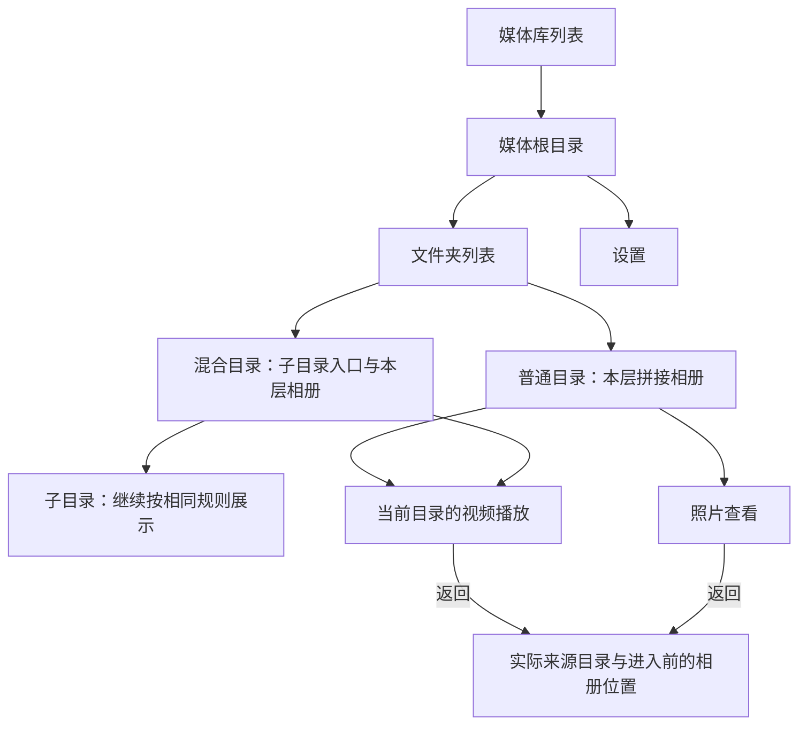

# VVideo 安卓 UI 改版实施方案

> 视觉部分已由 [2026-10-10 安卓 UI 重设计规范](2026-10-10-android-ui-telegram-style.md) 替代；本文保留为历史实施与验证记录，不作为当前颜色、布局和控件规范。

日期：2026-10-09。状态：**已按本方案实施，真机验收结果单独记录。** 代码、功能检查、性能结果与未通过项见 [验证记录](../ACCEPTANCE.md)；本文保留原设计约束，不将建议参数当作实测。

## 1. 已确认的方向与适用边界

用户的媒体按已有文件夹组织：多数视频直接位于文件夹内，少量目录存在嵌套。采用 **文件夹列表作为入口，进入目录后展示精简的十媒体拼接相册**。少量子目录作为独立导航项显示在本层媒体上方。保留轻量顶栏、克制的绿色强调色、清楚的层级和较小的相册缝隙。

这是一套页面随内容变化的设计，不是“文件管理器”和“相册”两种独立模式。不得将所有后代视频汇总到一个首页，不增加推荐流、底部多频道导航、跨目录连续播放或文件移动/删除功能。

[当前设计](../DESIGN.md)继续作为产品行为与性能门槛的单一来源；本文件记录 UI 施工方案，细化其表现方式，不另立缓存、排序或性能标准。颜色、尺寸、动效及控件显隐的具体数值是本方案的**实施默认建议**，并非用户逐项确认或已测得的结果。实施时若发现与当前设计冲突，先解决冲突，不能静默覆盖既有行为。

施工遵循[项目目录决策](../decisions/2026-10-08-project-layout.md)、[安卓目录规范](../../安卓目录规范.md)与[根协作要求](../../AGENTS.md)。保持现有 Kotlin、Compose、Media3 工程，不为本轮升级依赖、拆新生产模块或重构服务端。

## 2. 页面结构与导航



图中播放器、照片页也可从混合目录或任意子目录进入，返回目标始终是实际来源目录；不固定返回某个示例页面。

| 当前内容 | 页面主体 | 必须避免 |
| --- | --- | --- |
| 媒体库列表 | 展示服务端配置的媒体根入口，使用与文件夹列表一致的行样式 | 把多个媒体根的文件夹无来源地混在一起 |
| 只有文件夹 | 完整可浏览的纵向文件夹列表，按需分页 | 只露出两个文件夹、横向大胶囊、虚假的空相册提示 |
| 只有本层媒体 | 十项一组的拼接相册，不显示空“文件夹”区域 | 为目录导航预留一大块空白 |
| 子目录与媒体并存 | 上方为子目录行，下方为本层拼接相册；同一纵向滚动路径 | 将子目录混入十媒体分组，或把后代媒体递归混入当前页 |
| 真正空目录 | 简短空状态与返回、刷新入口 | 将离线、权限失败、加载中显示成空目录 |

“完整可浏览”表示所有目录入口都可到达，并不要求一次下载、渲染或常驻全部目录。子目录非常多时，仍需有界分页与可逆浏览；不能以本次用户主要是浅目录为由只实现小数据场景。

### 返回与恢复

1. 顶部返回、系统返回键和系统返回手势共用导航事件：先关闭弹层，再离开播放器/照片页/设置页，目录内则返回父目录；媒体根返回媒体库列表，只有最外层才允许退出应用。
2. 从设置返回原目录与原位置，不强制回到媒体库入口。未配置服务时仍进入首次连接流程，不能返回不存在的数据页。
3. 从播放器或照片页返回进入查看前的相册锚点，不用视频上下切换后的序号覆盖该锚点。
4. 冷启动按当前设计恢复最近目录、排序和媒体位置；“文件夹作为入口”不等于每次启动强制回首页。没有有效恢复记录时才从媒体库入口开始。
5. 父目录名称、返回关系以目录 ID 和服务端元信息为准。面包屑显示用户可理解的库名与目录名，不显示 NAS 绝对路径，也不依靠拼接字符串推导导航。

## 3. 视觉规范

### 3.1 颜色与系统栏

建议浅色、深色随系统切换，不新增主题设置页；使用同一组固定品牌色角色，避免动态取色再次混入另一套强调色。此为本方案的默认实施选择。播放器画布固定黑色，控件使用白色及统一绿色强调色。

下表是实施采用的颜色初值。每组前景与背景成对使用，不能只覆盖 `primary` 和 `surface` 后保留默认紫色。完成实际组件映射后检查对比度、禁用态与按压态；本表不是已验收的无障碍声明。

| Material 角色 | 浅色 | 深色 |
| --- | --- | --- |
| `primary` / `onPrimary` | `#246650` / `#FFFFFF` | `#9DDBC0` / `#073828` |
| `primaryContainer` / `onPrimaryContainer` | `#C3EED9` / `#082D20` | `#174E39` / `#C3EED9` |
| `secondary` / `onSecondary` | `#50665A` / `#FFFFFF` | `#B6CCBE` / `#22372D` |
| `secondaryContainer` / `onSecondaryContainer` | `#D3E8DA` / `#11271C` | `#394E42` / `#D3E8DA` |
| `tertiary` / `onTertiary` | `#42636A` / `#FFFFFF` | `#AACED5` / `#13353C` |
| `tertiaryContainer` / `onTertiaryContainer` | `#C6EAF1` / `#082E35` | `#2A4C53` / `#C6EAF1` |
| `background` / `onBackground` | `#F7F9F8` / `#1A2C24` | `#121917` / `#EEF5F1` |
| `surface` / `onSurface` | `#F7F9F8` / `#1A2C24` | `#121917` / `#EEF5F1` |
| `surfaceVariant` / `onSurfaceVariant` | `#E5ECE7` / `#52685E` | `#293A31` / `#BACCC1` |
| `surfaceContainerLowest` | `#FFFFFF` | `#0D1411` |
| `surfaceContainerLow` | `#F0F5F2` | `#17211C` |
| `surfaceContainer` | `#ECF2EF` | `#1E2B25` |
| `surfaceContainerHigh` | `#E5ECE7` | `#25332B` |
| `surfaceContainerHighest` | `#DEE7E1` | `#2D3C33` |
| `surfaceBright` / `surfaceDim` | `#F7F9F8` / `#D7E1DB` | `#334139` / `#121917` |
| `outline` / `outlineVariant` | `#718278` / `#CAD6CE` | `#8B9E91` / `#3C5043` |
| `inverseSurface` / `inverseOnSurface` | `#24382C` / `#EDF5EF` | `#E0ECE3` / `#203428` |
| `inversePrimary` | `#9DDBC0` | `#246650` |
| `error` / `onError` | `#BA1A1A` / `#FFFFFF` | `#FFB4AB` / `#690005` |
| `errorContainer` / `onErrorContainer` | `#FFDAD6` / `#410002` | `#93000A` / `#FFDAD6` |
| `surfaceTint` / `scrim` | `#246650` / `#000000` | `#9DDBC0` / `#000000` |

状态栏和导航栏图标明暗根据**实际页面背景**设置，不能仅按系统主题推断：深色页面及播放器使用浅色图标，浅色页面使用深色图标。处理刘海、手势区和系统边衬；普通页面不把标题或按钮贴进系统栏。播放器的黑色画布可延伸，控件仍避开安全区域。

### 3.2 字体、间距与形状

默认使用系统 Sans 字体，标题 Medium、正文 Regular。中文随平台字体回退；不下载远程字体。若以后单独选品牌字体，可比较“系统字体＋现有数字字形”与“打包 Noto Sans SC＋系统数字”两种方案；后一种增加安装体积，本轮不引入。

| 元素 | 建议初值 | 约束 |
| --- | --- | --- |
| 页面标题 | 20 sp，行高 28 sp，Medium | 大字体时允许栏高增长，不能挤掉返回与菜单 |
| 文件夹名 | 16 sp，行高 24 sp，Medium | 优先显示两行；更长时省略并可通过进入后的标题/路径查看完整名称 |
| 正文、设置行 | 14 sp，行高 20 sp，Regular | 使用语义颜色，不靠降低到难读的透明度分层 |
| 路径、次要说明 | 12 sp，行高 16 sp，Regular | 长路径保留当前层与紧邻父级，完整路径可在路径展开层查看 |
| 时长标记 | 12 sp，行高 16 sp，等宽数字 | 单行；不得缩小字体或省略时长来掩盖窄卡片问题 |
| 间距基础 | 4、8、12、16、20、24 dp | 同类组件统一使用，不随页面任意变化 |
| 顶栏 | 基础内容高度 56 dp，加系统边衬 | 图标视觉尺寸 20–24 dp，触控区域至少 48 × 48 dp |
| 文件夹行 | 最小高度 64 dp，左右内容边距 16 dp | 长名称或大字体时随内容增高，不硬裁切 |
| 文件夹图标底 | 40 × 40 dp，圆角 12 dp | 同色系低强调背景；图标与文字整行可点击 |
| 相册 | 外边距 12 dp，组内缝隙 2 dp，组间距 16 dp | 整组外轮廓圆角 12 dp，内部格子不各自叠圆角 |
| 设置分组与弹层 | 圆角 16 dp，内部间距 16 dp | 常规内容不依靠重阴影区分；弹层使用不透明表面 |
| 动效 | 小范围状态变化约 160–220 ms | 遵守系统动效设置；不使用循环闪光骨架、实时模糊或大面积视差 |

这些尺寸使用 dp/sp，不照搬网页示意的像素。触控区域可大于可见图标；所有图标动作都有可访问名称，焦点可见。方向键、键盘与屏幕阅读器按视觉顺序操作，弹层关闭后恢复合理焦点。

## 4. 文件夹入口与混合目录

### 页面布局

```text
系统状态栏
返回图标  当前目录名                 设置图标  ⋮
          媒体库 / 父级 / 当前目录

文件夹                                      名称顺序
文件夹图标  文件夹名称                         >
文件夹图标  较长的文件夹名称                   >
            必要时第二行
……按需继续加载……

本层媒体                      拍摄时间 · 最新在前
十媒体拼接相册
下一组相册
```

- 媒体库最外层没有返回按钮；目录页始终有返回入口。设置用标准齿轮图标，排序/刷新使用右上角 `⋮`，不保留大块“返回”“设置”文字按钮。
- 文件夹行以名称为主体，不强制添加视频数、总大小或文件夹封面。只有接口确实提供且不引起额外逐项查询时才展示辅助信息；不能为装饰递归统计整棵目录。
- “包含子目录”只能在数据已知时显示，不能为每一行另发网络请求探测。示意中的此类标签不是当前接口已有字段的承诺。
- 根入口完整展示文件夹列表；不得恢复成“两个文件夹＋查看全部”的默认结构。已加载内容不足时在列表边界显示轻量加载/重试，不遮挡已有目录。
- 混合目录在同一滚动容器内组合文件夹行和相册组，不嵌套两个同向可滚动列表。媒体区没有内容时省略该区；不要在尚未完成加载时提前显示空状态。
- 极宽目录采用有界窗口并能向前取回释放的项目。当前客户端 `children()` 只消费前向游标，实施前须明确补齐前向/反向恢复的接口或有界索引策略。不能继续使用 `takeLast(100)` 无声丢掉入口，也不能简单去掉上限无限追加。
- 文件夹顺序遵循服务端名称序。网页示意的本地排序只用于演示，不复制到正式客户端作为另一套排序规则。

## 5. 目录内拼接相册

1. 分组、排序与锚点语义沿用[当前设计](../DESIGN.md)。分组针对当前目录的完整顺序，不把刚下载的一页重新从零分组；最后一组允许不足十项。
2. 横竖比例参与布局，视觉顺序与媒体顺序一致。缩略图裁切只影响相册展示，全屏媒体保持原比例。旋转、容器宽度与字体缩放参与相关布局失效条件。
3. 视频右下角使用深色半透明单行时长标记；短视频为 `m:ss`，长视频采用 `h:mm:ss`。未取得有效时长显示“待解析”等真实状态，不伪造 `0:00`。
4. 最小卡片宽度需同时满足触控与时长可读性：依据实际字号、当前格式文本宽度、内外边距测量。极窄竖片应调整行划分或裁切策略，不能换行显示时间，也不能把时间直接截断。
5. 元信息已知时先预留对应比例的静态占位；图片到达不改变组高。无封面、生成中、请求失败、解码不支持有不同表现。局部失败保留卡片位置与其他已加载媒体。
6. 新入库、冷封面、短暂网络故障只对可见项进行有限重试并退避；有有效 `Retry-After` 时遵守。离屏、切目录和版本失效取消旧请求。404 本身不能一律解释为“正在生成”，必须结合媒体状态和响应语义。
7. 排序菜单保留拍摄/录制时间、文件修改时间、文件名及升降序，选中项清楚可见；排序只作用于媒体，不作用于文件夹行。刷新行为与已有版本/锚点恢复规则一致。
8. 文件夹行改为独立列表项后，必须删除现有“相册索引固定加一”的布局假设。保存/恢复锚点及触底/触顶加载使用稳定项目类型与 ID，不能以新 UI 的绝对列表下标代替媒体索引。

## 6. 视频播放与照片查看

### 视频页面

```text
返回                                  详情

            保持原比例的视频画面

文件名
播放/暂停    细进度轨道与拖动手柄
当前时间                              总时长
```

- 延续当前目录的视频队列和上下滑动切换，跨十项分组但不跨目录；照片不自动塞进视频队列。
- 黑色画布、轻渐变控件遮罩、标准图标。文件名通常单行省略，详情可查看完整名称、时间来源、格式等已有信息。
- 进度轨道视觉变细，触控带仍至少 48 dp 高。拖动进度与上下翻页需要明确手势归属，拖动中不翻页；暂停/播放不改变视频速度或定位语义。
- 点击画面切换控件显示。建议连续播放约 3 秒且没有交互后自动隐藏；暂停、错误、拖动、弹层打开或无障碍焦点在控件上时保持可见。具体延时按实机操作调整。
- 封面在真实首帧出现后移除；等待、缓冲和失败都有明确反馈。设备不支持的格式显示原因，不自动转码、不让重试无限循环。
- 不为新控件或相邻页新增播放器。控件显示变化不重建媒体会话；播放进度仅驱动必要控件更新。
- 示意中的“上一条/下一条”按钮用于演示目录边界，**不替代正式版上下滑动**；示例中的 `1 / 10` 也不代表实际队列只有十条。没有可靠总数时不显示虚假的全目录计数。

### 照片页面

保留原图显示、现有缩放/平移与返回功能，使用同一套返回和详情图标。明确 `加载中 / 已就绪 / 失败`，元信息失败及原图请求失败都能显示原因并局部重试，不以黑屏作为错误反馈。本轮不新增未定义的跨照片翻页手势，也不让图片缩放手势触发视频翻页。

## 7. 设置与首次连接

首次连接仍直接展示服务地址、令牌和“保存并连接”。已配置时使用两块清晰分组：

```text
返回  设置

服务连接
媒体服务名称或脱敏地址      实际连接状态
修改连接

媒体缓存
已使用合计                 当前上限
视频占用
图片占用
1 GB          5 GB          10 GB
清理媒体缓存
操作状态与简短说明
```

- “修改连接”展开或进入明确的编辑区域，令牌默认遮盖。输入错误贴近字段；连接错误靠近提交动作，保存中禁止重复提交。
- 已保存不等于已连接。状态至少区分已保存/未验证、连接中、连接成功、不可达、鉴权失败；只在真实响应支持时显示“已连接”。不把假服务地址、测试令牌或“已连接 · 示意”写入正式资源。
- 1/5/10 GB 用同一组选项表达互斥选择，选中态统一使用主题强调色。容量单位、视频与图片的总预算、管理开销和低存储行为沿用当前设计。
- 用量数值由实际统计提供，加载期间显示“正在计算”而非零值。管理开销以次要行展示，磁盘与内存的区别放简短说明或帮助内容，不占据主标题层级。
- 清理显示开始、进行中、成功/失败，保留排序、连接与浏览记录；播放中清理需明确暂停并协调活动读写。UI 只发送事件，统计和清理保持后台执行，不增加主线程缓存目录遍历。
- 服务地址的 HTTPS/内网 HTTP 策略沿用现有验证和网络安全配置，不因为新表单删掉限制或只改文案放行。

## 8. 统一状态与文案

| 状态 | 表现 | 用户动作与数据保护 |
| --- | --- | --- |
| 首次加载 | 稳定骨架/占位与轻量进度 | 返回可用；不写入空浏览锚点 |
| 加载更多 | 列表边界进度 | 已加载内容继续可用；重复触发去重 |
| 确认空目录 | “此文件夹暂无可显示的媒体”或仅展示现有子目录 | 返回、刷新；与离线区分 |
| 服务不可达或媒体根离线 | 保留已有内容，简短离线提示 | 重试、设置；保留目录和书签 |
| 鉴权失败 | “连接凭据无效，请检查设置” | 修改连接；不重复轰炸服务 |
| 封面生成中 | 保持比例占位与轻量状态标记 | 有限自动恢复；不触发全库取图 |
| 封面请求失败 | 局部错误图标或可访问状态 | 局部重试；仍允许按真实媒体状态进入播放 |
| 视频/照片不支持 | 明确“不支持此媒体格式”等经过分类的原因 | 返回或查看详情；不承诺重试可修复 |
| 目录版本变化 | 受控刷新并按稳定 ID 重定位 | 不拼接不同修订的数据 |
| 锚点媒体确已删除 | 简短提示并定位邻近有效媒体 | 不把暂时读取失败当成删除 |
| 缓存操作 | 动作旁显示进度与结果 | 阻止冲突操作，完成后更新真实用量 |

当前 API 客户端将部分非成功响应统一变成异常。细分状态需要在数据层保留必要的错误类型；不能只改 Screen 文案，或猜测所有请求失败都是断网。所有可见文案进入字符串资源，日志不包含令牌或无关私有路径。

## 9. 实施位置与顺序

下列为已有文件的计划修改范围，不要求把全部实现塞进一个 Kotlin 文件。**单文件交付指本方案文件；产品代码仍按职责分开。** 新组件仅在有实际使用方时创建。

| 阶段 | 已有位置 | 工作内容 |
| --- | --- | --- |
| 1 主题与系统栏 | [VVideoTheme.kt](../../android/app/src/main/kotlin/dev/vvideo/ui/theme/VVideoTheme.kt)、[MainActivity.kt](../../android/app/src/main/kotlin/dev/vvideo/app/MainActivity.kt) | 补齐成对颜色、字体/尺寸；统一系统栏与边衬。真实复用的 token 放 `ui/theme/` |
| 2 导航与目录状态 | [VVideoRoot.kt](../../android/app/src/main/kotlin/dev/vvideo/app/navigation/VVideoRoot.kt)、[LibraryViewModel.kt](../../android/app/src/main/kotlin/dev/vvideo/feature/library/LibraryViewModel.kt) | 系统返回、父级返回、目录与设置恢复；按项目类型处理列表锚点；补齐目录分页回取 |
| 3 文件夹与相册 | [LibraryScreen.kt](../../android/app/src/main/kotlin/dev/vvideo/feature/library/LibraryScreen.kt)、[AlbumLayoutCalculator.kt](../../android/app/src/main/kotlin/dev/vvideo/feature/library/album/AlbumLayoutCalculator.kt) | 文件夹纵向行、相册层级、最小可读卡片与时长标记、占位/重试。专属组件留在 `feature/library/` |
| 4 数据状态 | [LibraryApi.kt](../../android/app/src/main/kotlin/dev/vvideo/data/library/remote/LibraryApi.kt)、[PageWindow.kt](../../android/app/src/main/kotlin/dev/vvideo/data/library/PageWindow.kt)、[Bookmarks.kt](../../android/app/src/main/kotlin/dev/vvideo/data/library/local/Bookmarks.kt) | 按实际需要区分错误、协调取消与版本、保持有界窗口和恢复；不为 UI 复制整库 |
| 5 查看媒体 | [PlayerScreen.kt](../../android/app/src/main/kotlin/dev/vvideo/feature/player/PlayerScreen.kt)、[PlayerViewModel.kt](../../android/app/src/main/kotlin/dev/vvideo/feature/player/PlayerViewModel.kt)、[MediaDetails.kt](../../android/app/src/main/kotlin/dev/vvideo/feature/player/MediaDetails.kt) | 轻量控件、显隐/拖动状态、原图失败恢复；保持媒体会话与 UI 职责边界 |
| 6 设置 | [SettingsScreen.kt](../../android/app/src/main/kotlin/dev/vvideo/feature/settings/SettingsScreen.kt)、[SettingsViewModel.kt](../../android/app/src/main/kotlin/dev/vvideo/feature/settings/SettingsViewModel.kt)、[CacheCoordinator.kt](../../android/app/src/main/kotlin/dev/vvideo/data/cache/CacheCoordinator.kt) | 连接摘要/编辑、真实状态、统一容量选择、清理反馈；非必要不改缓存内部算法 |
| 7 资源与验证 | [app 资源目录](../../android/app/src/main/res/)、[Android README](../../android/README.md)所列测试入口 | 文案和矢量图标、行为测试、真机截图与性能复测 |

实施顺序：先打通目录导航和状态正确性，同时建立统一主题；再完成目录/相册主路径，随后调整播放器、照片与设置，最后复测并审查。不要先做大量装饰后再补返回与分页。

已有 review 发现的四个 lint 错误要纳入交付收尾：媒体模块 [SeekRenderersFactory.kt](../../android/core/media/src/main/kotlin/dev/vvideo/core/media/playback/SeekRenderersFactory.kt) 的 API 版本调用检查，以及 [DevicePlaybackTest.kt](../../android/app/src/androidTest/kotlin/dev/vvideo/DevicePlaybackTest.kt) 的 Compose 内 ViewModel 构造和 Flow 取值。它们与视觉美化不同，应单独说明修复与验证；API lint 报错不能直接当作旧系统必然崩溃的证据。

若子目录反向取回必须补充服务端接口，先在 [API 契约](../API.md)确定语义，并遵守 [PERF-01 至 PERF-12](../IMPLEMENTATION.md)。这是目录大数据正确性的实现成本，不能以“仅做 UI”为由隐藏，也不授权顺带改造扫描/存储架构。

## 10. 验证与完成标准

### 功能与视觉检查

| 场景 | 验收要点 |
| --- | --- |
| 多媒体根、纯目录、纯媒体、混合目录 | 正确显示对应结构；不跨库或递归混合媒体 |
| 普通目录与少量嵌套 | 顶部返回、系统键/手势返回一致；父级正确；设置与播放返回保持来源 |
| 101、200 及更多子目录的合成场景 | 向后加载后仍可回到早期目录，无漏项/重复；元信息保持有界 |
| 含十项、末组不足十项、极端宽高比 | 顺序正确，组不跳动；窄竖视频时间单行可读 |
| 普通与系统大字体、浅深主题、横竖屏 | 系统栏可辨识，触控与焦点可用，长名称/路径不压住动作；时长含小时也完整 |
| 新封面未就绪、冷封面、短断网后恢复 | 可见项有限恢复，离屏取消；不重复全库请求 |
| 元信息失败、原图失败、格式不支持 | 有明确错误态与适当动作，不出现无说明黑屏 |
| 排序、刷新、数据修订、返回和重启 | 按当前设计维持排序及锚点；新 UI 项目数量变化不破坏恢复 |
| 视频快速正反翻页与进度拖动 | 画面、声音、目标媒体一致；手势不冲突；控件显隐不重建播放器 |
| 缓存选择、缩减、清理与播放竞争 | 真实反馈、活动读写协调、配置和浏览记录保留 |

测试要覆盖行为，不为圆角/颜色常量写与实现一一对应的单元测试。为目录窗口、列表项目到媒体锚点的映射、返回事件、窄卡片布局及失败恢复补充有价值的测试；真实图片、解码、系统边衬和手势仍需设备检查。

### 构建与检查入口

以下命令从仓库根执行，来自现有 Wrapper、模块及变体，供实施后运行；本次仅编写文档，没有重新执行它们。运行环境使用 [Android README](../../android/README.md)规定的工具链，不在计划中写入某台机器的 JDK/SDK 绝对路径。

```sh
android/gradlew -p android :app:testDebugUnitTest :core:media:testDebugUnitTest :app:lintDebug :core:media:lintDebug :app:assembleDebug
android/gradlew -p android :app:assembleProfile :benchmark:assembleProfile
```

设备行为测试的目标与测试 APK 必须匹配，具体安装与运行入口沿用 Android README。不得用 `device` 变体的表现替代经缩减优化的 `profile` 性能结果。

### 性能与代码审查

- 在 iQOO 12 Pro 的真实 profile 构建上复测本次影响的目录滚动、拼接布局、冷/暖封面、全屏翻页和返回恢复；记录 APK 摘要、系统/刷新率、网络、媒体与缓存条件。
- 数值门槛、轮数和长期内存要求继续引用[当前设计的性能验收计划](../DESIGN.md#性能验收计划)及[既有验收记录](../ACCEPTANCE.md)，不在本文件复制另一套数字。界面示意、静态截图和旧 APK 的通过记录不代表新实现达标。
- 目录分页、布局与图片请求维持可见窗口和有界驻留；播放器数量、RAM 缓冲与磁盘缓存预算分别管理。增加文件夹封面、实时模糊、全量统计等不在本计划内。
- 可执行代码修改完成后按根协作要求运行 `open-code-review`，逐条核实有效发现并验证修复。2026-10-09 记录时当前目录尚未初始化 Git；执行时重新确认条件，不初始化仓库伪造审查，也不把未运行说成通过。
- 实施交付说明必须区分：页面完成、行为检查通过、性能通过、未测条件。完成后按实际变更更新当前设计/验收记录，保持中英文 README 的状态与命令语义一致，不把此计划当作新的验收结果。

## 11. 单文件使用说明

本文件已经包含确认方向、页面结构、视觉参数、交互规则、状态表、源码落点和验收清单，可直接作为后续实现的输入。无需依赖聊天里的临时预览路径或测试截图才能理解需求。

聊天示意只用于表达布局：虚构的目录名、彩色封面、固定数量、连接状态以及预览控制按钮都不是用户真实数据或已经实现的产品能力。最终成品以原生安卓组件、实际服务端数据、上述目录语义及真机验证为准。
