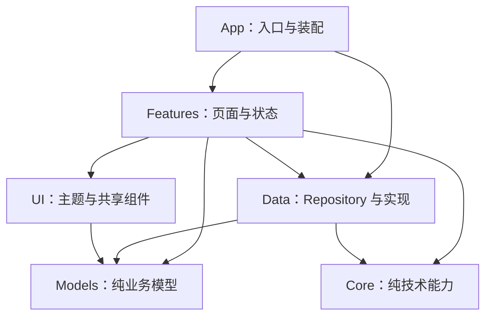

# iOS 应用目录规范

基线版本：1.0.0。适用范围：以 Swift 编写、由 Xcode 构建的原生 iOS / iPadOS 应用，及其 App Extension、测试 target 和本地 Swift 包。

本文是 [目录规范.md](目录规范.md) 的平台扩展基线，补充通用基线未覆盖的原生 iOS 项目类型。总则、根目录、文档、脚本、AI 工作流程和迁移验收仍以通用基线为准；本文只规定 iOS 应用根的位置、应用根内部归属，以及通用目录在 iOS 上的固定映射。本文不得放宽通用基线；第 11 节已列出的映射属于本基线的一部分，采用项目无需重复登记，其他偏差按通用基线第 11 节记录在项目 README 的“目录例外”中。

“必须 / 禁止 / 默认 / 按需创建”的含义与通用基线相同。目录树中的占位名、示例类型和按需目录用于解释规则，不是待创建清单，也不代表任何项目已存在 Xcode 工程。

本文管理文件归属、依赖边界与交付检查，不指定 SwiftUI / UIKit 取舍、状态管理框架、网络库或发布渠道；也不写入 Xcode、Swift、最低系统版本等具体数字，这些记录在项目 README 和真实工程配置中。

不在本文范围：React Native、Flutter、Kotlin Multiplatform 等跨平台工程，独立的 macOS、watchOS、tvOS、visionOS 应用，以及以 Objective-C 为主的旧工程整体迁移。遇到这些情况，按通用基线第 11 节第 4 条提出具体布局，由用户决定后记录。

### AI 入口

- 采用本文件的仓库在根 `AGENTS.md` 中与 `目录规范.md` 一并引用，要求修改 iOS 工程前读取；不复制正文。
- 先遵守运行环境强制指令与用户本次要求，再使用项目目录例外、本文和通用基线。Xcode 模板的默认分组、示例工程目录和现有违规结构不构成例外依据。
- Xcode 会在打开、升级或解析依赖时自动改写工程文件。提交前检查差异，不把与任务无关的工程升级、排序变化或个人设置混入变更。

## 1. 参考与选择

已核实的参考：

- [Managing files and folders in your Xcode project](https://developer.apple.com/documentation/xcode/managing-files-and-folders-in-your-xcode-project)：组与文件夹的区别、与磁盘同步的文件夹及其 target 成员例外。
- [Organizing your code with local packages](https://developer.apple.com/documentation/xcode/organizing-your-code-with-local-packages)：在应用工程内用本地 Swift 包拆分模块。
- [Privacy manifest files](https://developer.apple.com/documentation/bundleresources/privacy-manifest-files)：`PrivacyInfo.xcprivacy` 的固定文件名及其必须属于 target 资源。
- [Build configuration file (xcconfig) format](https://help.apple.com/xcode/mac/current/en.lproj/dev745c5c974.html)：xcconfig 语法及 `#include?` 可选包含。

以下结构是本基线的选择，不是 Apple 唯一推荐的目录树，也不照搬任何模板或开源项目的全部 target、脚本和发布流程。

## 2. 应用根与工程定义

### 2.1 应用根

iOS 应用根固定为 `ios/`，不使用 `iOS/`、`app/`、`mobile/`、`client/` 或以产品名命名的顶层目录。Xcode 打开该目录内的工程，`xcodebuild` 以该工程为对象执行。

| 仓库情况 | iOS 应用根 |
| --- | --- |
| 只有一个 iOS 应用 | 仓库根下的 `ios/`；README、规范、AGENTS 和 CI 仍在仓库根，不因没有其他应用把工程提到根目录 |
| 后端、Web 或 Android 与一个 iOS 应用共仓 | 后端按通用基线放根目录，Web 为 `web/`，iOS 为 `ios/`，彼此通过网络协议或显式包依赖协作 |
| 用户明确要求的多应用仓库 | `apps/<应用名>/ios/`，按通用基线第 10 节 |
| 只发布 Swift 包、没有 App | 包根即应用根：`Package.swift`、`Sources/<模块>/`、`Tests/<模块>Tests/`；不创建 `ios/` |

同一应用的主 App、Extension 和测试属于一个 iOS 应用根，不因 target 增多而启用 `apps/`。

### 2.2 工程定义的唯一来源

一个 iOS 应用只选择以下一种工程定义方式，并在 README 写明：

| 方式 | 提交内容 | 生成物 |
| --- | --- | --- |
| A：Xcode 工程（默认） | `ios/<App>.xcodeproj/`，其中的 `project.pbxproj`、共享 scheme 和包锁文件 | 无 |
| B：工程生成器 | 生成器清单，例如 XcodeGen 的 `project.yml` 或 Tuist 的 `Project.swift` 及其所需文件 | 生成的 `.xcodeproj` / `.xcworkspace` 被忽略，不手改 |

- 不同时维护手改工程和生成器清单。采用或退出生成器属于工具决策，须用户确定并记录；迁移后移除旧的定义来源。
- 方式 A 在所用 Xcode 支持时，target 源码使用与磁盘同步的文件夹，减少 `project.pbxproj` 冲突；仅确需排除或改变成员关系的文件记录为文件夹例外。
- 仍使用传统组时，组结构必须与磁盘目录一致：不创建无对应目录的虚拟组，不让组名与目录名不同，不把文件放在与所属组不同的磁盘位置。
- 只有多个 Xcode 工程或所用工具确需时才创建 `ios/<App>.xcworkspace`。仅添加本地 Swift 包不需要 workspace。
- 依赖默认使用 Swift Package Manager。新工程不引入 CocoaPods 或 Carthage；已有工程沿用现有工具，迁移作为单独任务决定，不在同一应用并用两套依赖管理。

### 2.3 预期结构

以方式 A 为例，仅创建有实际内容的部分：

```text
ios/
├── <App>.xcodeproj/
│   ├── project.pbxproj
│   ├── project.xcworkspace/xcshareddata/swiftpm/Package.resolved  # 有远程包依赖时提交
│   └── xcshareddata/xcschemes/   # CI 和团队共用的 scheme
├── <App>/                        # 主应用 target 源码根，名称与 target 一致
│   ├── App/                      # @main 入口、Scene / AppDelegate、根导航与依赖装配
│   ├── Features/<Feature>/       # 业务域页面、状态、专属组件与资源
│   ├── Data/<Domain>/            # Repository、网络、持久化及边界映射
│   ├── Models/                   # 多个业务域实际共用的纯模型
│   ├── Core/<Capability>/        # 按能力命名的跨域纯技术逻辑，按需
│   ├── UI/                       # Theme/ 与真实跨域复用的 Components/
│   ├── Resources/                # Assets.xcassets、String Catalog、PrivacyInfo.xcprivacy
│   ├── PreviewContent/           # 仅 Xcode 预览使用的数据与资源，按需
│   ├── Info.plist                # 仅构建设置无法表达时创建
│   └── <App>.entitlements        # 实际启用 capability 时创建
├── <App>Tests/                   # 主应用单元测试 target
├── <App>UITests/                 # UI 测试 target，按需
├── <Extension>/                  # 每个 App Extension 一个 target 目录，按需
├── Packages/<Package>/           # 本地 Swift 包，按需
│   ├── Package.swift
│   ├── Sources/<Module>/
│   └── Tests/<Module>Tests/
├── Configs/                      # xcconfig 与导出选项等构建配置
├── TestPlans/                    # 共享 .xctestplan，按需
├── build/                        # DerivedData、archive、导出包，不提交
└── test-results/                 # .xcresult 与导出的测试报告，不提交
```

`<App>`、`<Feature>` 等为占位名。方式 B 下，同一结构中的 `<App>.xcodeproj/` 是生成物，生成器清单放在 `ios/` 根。

### 2.4 命名

- `ios/` 本身及 `build/`、`test-results/` 等通用产物目录沿用通用基线的小写名称。
- `ios/` 内的 target、Swift 模块和源码分组目录使用 PascalCase，与 Swift 类型和 Xcode target 命名一致；本文固定的 `App/`、`Features/`、`Data/`、`Models/`、`Core/`、`UI/`、`Resources/`、`PreviewContent/`、`Packages/`、`Configs/`、`TestPlans/` 不另造同义名。
- 目录名不含空格。Xcode 模板生成的带空格分组（例如预览资源组）在创建工程时改为本文名称，并同步相应构建设置。
- SwiftPM 规定的 `Sources/`、`Tests/` 和 target 子目录按工具约定使用。
- Swift 文件以主类型命名，例如 `LibraryView.swift`、`LibraryModel.swift`；扩展文件命名为 `<Type>+<Capability>.swift`，放在拥有该能力的位置。不创建一个文件收纳全部模型或扩展。

### 2.5 构建配置与本地文件

- 构建设置默认集中在 `ios/Configs/` 的 xcconfig 中，例如 `Shared.xcconfig`、`Debug.xcconfig`、`Release.xcconfig`。同一设置只在一处定义：已由 xcconfig 管理的项不在工程编辑器中再设一份。
- 个人签名团队、本机设备用的 bundle identifier 后缀等放被忽略的 `Configs/Local.xcconfig`，由共享 xcconfig 以 `#include? "Local.xcconfig"` 可选包含；缺失时仍能完成不签名的模拟器构建。
- 证书、`.p12`、`.mobileprovision`、App Store Connect API 密钥和签名密码不得提交；CI 从平台密钥管理注入。导出用的 `ExportOptions*.plist` 只在实际使用时放 `Configs/`，不含秘密。
- `Configs/` 只保存构建配置。应用运行时的服务地址等若需按构建区分，通过构建设置注入并在 README 说明；真实地址和凭据不写入示例源码或预览数据。
- 有远程包依赖时提交 Xcode 生成的 `Package.resolved`；CI 只使用其中锁定的版本，不在构建中静默升级依赖。
- 所需 Xcode、Swift 语言模式与最低部署版本写入真实工程配置和 README；采用 `.xcode-version` 等工具文件时以其为准。不写“最新版”。
- Git 至少忽略 `xcuserdata/`、`*.xcuserstate`、`ios/build/`、`ios/test-results/`、本地 xcconfig、本地包的 `.build/` 与 `.swiftpm/`，以及 `.ipa`、`.xcarchive`、`.dSYM` 等产物；方式 B 同时忽略生成的工程。
- Xcode Run Script 阶段只保留短调用并声明输入 / 输出文件；可复用逻辑按通用基线放仓库 `scripts/`，脚本按自身位置定位仓库根。不为转发 `xcodebuild` 新建 Makefile 或包装脚本层；采用 fastlane 时，其工具目录为 `ios/fastlane/`，仅承载实际发布流程。
- 采用 swift-format、SwiftLint 等工具时，配置文件放 `ios/` 根并固定版本与调用方式；未采用前不声称已执行。

## 3. 主应用 target 内部归属

以下路径相对于 `ios/<App>/`。

| 路径 | 内容 | 不应承担的职责 |
| --- | --- | --- |
| `App/` | `@main` 入口、Scene 与生命周期、根导航、依赖装配 | 业务规则、网络协议解析、页面实现 |
| `Features/<Feature>/` | 某业务域的页面、状态模型、专属组件、专属资源和辅助计算 | 直接创建网络客户端或数据库连接；导入其他业务域的私有类型 |
| `Data/<Domain>/` | Repository、`Remote/` 接口与 DTO、`Local/` 持久化与实体、边界映射 | 引用视图、视图控制器或业务域状态模型 |
| `Models/` | 已被多个业务域使用的纯业务模型 | UI 类型、网络编码细节、持久化实体 |
| `Core/<Capability>/` | 多个业务域实际使用的纯技术能力，例如日志、时间格式 | 业务规则；直接放在 `Core/` 下的零散文件 |
| `UI/Theme/` | 颜色、字体、间距等主题 token | 页面业务状态 |
| `UI/Components/` | 实际跨业务域复用的展示组件 | 单一业务域专属组件、数据访问 |
| `Resources/` | target 级资源目录、String Catalog、隐私清单、字体 | 源码、测试 fixture、预览专用数据 |
| `PreviewContent/` | 仅预览使用的合成数据与资源 | 被正式代码引用的数据 |

- 仅被一个业务域使用的内容就近放在该 `Features/<Feature>/`；出现第二个真实使用方后再评估提取，不先放公共目录再寻找使用方。
- 禁止新增职责不明的 `Common/`、`Shared/`、`Utils/`、`Helpers/`、`Misc/`、`Managers/`、`Extensions/` 收纳目录，也不按全局 `Models/Views/Controllers/` 或 `Screens/`、`ViewControllers/`、`Features/` 并建两套页面目录。
- SwiftUI 与 UIKit 代码按业务域放置，不按框架另建平行目录树。故事板和 XIB 只在实际使用时靠近所属业务域；启动画面优先使用 Info.plist 配置，确需故事板时放 `Resources/`。
- `Data/<Domain>/` 下仅在同时存在远程和本地来源时再分 `Remote/`、`Local/`；单一来源时不预建子目录。

## 4. 依赖与状态方向



- `Data/`、`Models/`、`Core/`、`UI/` 不得引用 `Features/` 或 `App/`；`Core/` 不得引用任何业务目录。
- 业务域之间通过导航值（ID、筛选条件等）和明确状态契约协作，不共享对方的状态模型或私有视图。
- 同一 target 内的 Swift 文件互相可见，目录边界不会由编译器保证；代码审查必须检查类型引用方向，不能仅凭目录树声称已隔离。需要编译器强制边界时，按第 5 节拆为本地包并只公开必要接口。
- 视图接收状态与回调，可在预览和测试中独立构造；视图的 `body` 或布局回调中不执行网络、文件读写和大规模计算。
- 界面状态在主 actor 上修改；耗时工作在后台执行，并支持取消。不以“全部移到后台线程”为由从错误线程调用 UIKit 或系统框架。
- DTO 与持久化实体默认在 `Data/` 边界映射为业务模型。若项目决定让视图直接观察 SwiftData / Core Data 对象，须记录在项目设计文档中，不由个别页面自行决定。
- 不用全局可变单例充当服务定位器。系统单例在需要替换或测试时于边界封装，由 `App/` 装配注入。

## 5. 本地 Swift 包与模块拆分

- 默认从单一主应用 target 开始，业务域按目录划分。只有出现编译隔离、与 Extension 复用、构建耗时或测试隔离的实际需求时，才拆出本地包；拆分须记录决策并一次性迁移，不保留两份实现。
- 本地包固定放 `ios/Packages/<Package>/`，包内采用 SwiftPM 布局。包按真实依赖边界划分，product 只暴露实际需要的模块；默认使用 `internal`，跨模块仅公开必要接口。
- 包的资源放 `Sources/<Module>/Resources/` 并在 `Package.swift` 中声明，通过 `Bundle.module` 访问；不跨包读取对方资源。
- 本地包不得依赖主应用 target，不得以相对路径引用 `ios/<App>/` 中的源码；包之间的依赖方向与第 4 节一致，禁止循环依赖。
- 应用的依赖锁定以应用工程的 `Package.resolved` 为准。独立发布到其他仓库的包按其自身的 SwiftPM 发布规则处理，不属于本节的本地包。

## 6. App Extension 与多 target

- 每个 Extension 一个 target 目录 `ios/<Extension>/`，名称与 target 一致，其 Info.plist、entitlements 和专属源码放在该目录内。
- 主应用与 Extension 共享的代码进入本地包或框架 target；不把同一源文件同时加入多个 target 的成员关系来共享实现。
- App Group、Keychain 共享组等标识在 entitlements 与 xcconfig 中各有唯一定义；访问共享容器的代码只有一处实现。
- 新增 watchOS、macOS 等其他平台 target 超出本文范围，按本文开头说明处理。

## 7. 资源、本地化与平台文件

- 每个 target 或包默认一个 `Assets.xcassets`，资源目录内按业务域建文件夹区分；同一图片或颜色不维护两份。主题颜色只在资源目录或 `UI/Theme/` 中选定一处作为来源。
- 用户可见文本使用 String Catalog（`Localizable.xcstrings`）；Info.plist 中的权限说明等使用对应的 `InfoPlist` 表。同一字符串表不同时保留 `.strings` 与 `.xcstrings`，正式代码不硬编码用户可见文案。
- Info.plist 优先由构建设置生成；仅有构建设置无法表达的键时才创建 `Info.plist` 文件。
- 隐私清单固定命名为 `PrivacyInfo.xcprivacy`，必须属于对应 target 的资源；包含第三方 SDK 时核对其自带清单，不复制一份冒充。
- entitlements 只声明实际启用的 capability，并与签名配置一致。
- 字体放 `Resources/Fonts/`，附带许可依据。
- `PreviewContent/` 加入该 target 的开发资源路径，使其不进入发布构建；预览使用合成数据，不使用真实账号、地址或用户内容。
- 使用同步文件夹时，Info.plist、entitlements、xcconfig 和说明文档不得被当作资源复制进包；以构建产物的实际内容核对，而非只看工程编辑器。

## 8. 运行状态与沙盒

iOS 应用在设备上的状态位于应用沙盒，源码树中不创建 `data/` 或 `.cache/`：

- 持久且用户不直接管理的数据放 Application Support，可重建缓存放 Caches，临时文件放 tmp；只有用户可见、可管理的文档放 Documents。
- 小型偏好设置使用 UserDefaults；凭据和令牌使用 Keychain，不写入偏好设置、普通文件或日志。
- Caches 可能被系统清理，内容必须可重建；可重新下载的大文件按需排除出系统备份。
- 模拟器数据、设备日志、崩溃报告和性能 trace 不提交到仓库；需要保留的验收结论写入项目文档。

## 9. 测试、fixture 与报告

- 主应用单元测试放 `ios/<App>Tests/`，目录结构对应被测源码；包测试放 `Tests/<Module>Tests/`。文件命名为 `<被测类型>Tests.swift`。
- UI 测试放 `ios/<App>UITests/`，只覆盖需要真实界面驱动的流程；可在单元测试中验证的逻辑不放 UI 测试。
- XCTest 与 Swift Testing 可按所用工具链支持选用，同一测试不在两套框架中重复实现。
- 固定输入放所属测试 target 的 `Fixtures/` 并作为测试资源加入；包测试通过 `Package.swift` 声明资源。测试媒体和数据使用合成内容或来源、使用权明确的样本，不复制真实用户数据。
- 已评审的快照基线放所用测试工具规定的目录并提交；失败差异、截图和日志写入 `ios/test-results/`。
- 共享测试计划放 `ios/TestPlans/`，由共享 scheme 引用。
- 命令行构建使用 `-derivedDataPath ios/build/DerivedData`，测试结果使用 `-resultBundlePath ios/test-results/<名称>.xcresult`；覆盖率从结果包中读取或导出到 `ios/test-results/`，不散落到仓库根。
- 跨应用的协议或契约测试（例如 iOS 与后端）按通用基线放仓库 `tests/`；只测试 iOS 自身的代码留在 iOS 测试 target。
- 性能结论使用真机和 Release 或等效优化构建测量，并记录机型、系统版本和数据条件；模拟器和预览不作为性能证据。

## 10. 检查入口

以下为占位示例，scheme、destination 和测试计划必须来自实际工程，先用 `-list` 确认；本文存在不代表任何命令已可运行或已通过。

```sh
xcodebuild -list -project ios/<App>.xcodeproj
xcodebuild -resolvePackageDependencies -project ios/<App>.xcodeproj -onlyUsePackageVersionsFromResolvedFile
xcodebuild test -project ios/<App>.xcodeproj -scheme <Scheme> -destination '<destination>' -derivedDataPath ios/build/DerivedData -resultBundlePath ios/test-results/<名称>.xcresult
```

README 记录实际命令、所需 Xcode 版本来源和需要真机或签名的步骤。无设备、无签名或无对应 Xcode 时，交付说明写明未执行项，不以模拟器构建通过代替真机验证。

## 11. 与通用基线的映射

以下映射属于本基线，采用项目无需在 README 重复登记；未列出的部分继续遵循通用基线。

| 通用基线规则 | iOS 上的固定做法 |
| --- | --- |
| 第 2、4 节应用根 | 原生 iOS 应用根为 `ios/`；多应用仓库为 `apps/<应用名>/ios/` |
| 第 4 节 `src/` | 源码位于各 target 目录与 `Packages/<Package>/Sources/`；不创建 `ios/src/` |
| 第 4 节 `tests/` 与 `fixtures/` | 测试位于各测试 target 与包的 `Tests/`，固定输入为 `Fixtures/`；仓库 `tests/` 只放跨应用测试 |
| 第 4 节 `dist/` | 构建、archive 和导出产物位于 `ios/build/` |
| 第 4 节 `test-results/`、`coverage/` | 结果包与导出报告位于 `ios/test-results/`，覆盖率随结果包保存或导出于此 |
| 第 4 节 `configs/` | `ios/Configs/` 只放构建配置；仓库内没有 iOS 运行配置实例 |
| 第 4 节小写连字符命名 | `ios/` 内 target、模块与源码分组使用 PascalCase，见第 2.4 节 |
| 第 7 节 `data/`、`.cache/` | 设备运行状态位于应用沙盒，见第 8 节 |
| 第 11 节工具必需路径 | `.xcodeproj` / `.xcworkspace` 内部结构、`xcshareddata/`、SwiftPM 的 `Sources/` 与 `Tests/`、`fastlane/`、快照工具目录按工具约定 |

## 12. 文件归属判定示例

| 场景 | 归属与约束 |
| --- | --- |
| 仓库只有一个 iOS 应用 | 工程在 `ios/`，README、规范、AGENTS 与 CI 在仓库根 |
| 只在设置页使用的开关组件 | `ios/<App>/Features/Settings/`；第二个业务域使用后再评估移入 `UI/Components/` |
| 多个业务域使用的按钮样式 | `ios/<App>/UI/Components/`，不导入数据层或业务状态 |
| 多个业务域使用的日期格式化 | `ios/<App>/Core/DateFormatting/`，不建 `Utils/` |
| `String` 的业务专属扩展 | `String+<Capability>.swift` 放在使用它的业务域内 |
| 后端接口 DTO 与映射 | `ios/<App>/Data/<Domain>/Remote/`，映射为 `Models/` 或业务域模型后交给界面 |
| 主应用与小组件共用数据读取 | 提取到 `ios/Packages/<Package>/`，两个 target 依赖该包 |
| 个人开发者签名团队 | 被忽略的 `ios/Configs/Local.xcconfig` |
| CI 签名证书 | CI 平台密钥管理，不进入仓库 |
| 预览用的示例数据 | `ios/<App>/PreviewContent/`，不被正式代码引用 |
| 单元测试固定 JSON | `ios/<App>Tests/Fixtures/` |
| 测试失败截图与结果包 | `ios/test-results/`，被忽略 |
| iOS 与后端的契约测试 | 仓库根 `tests/` |

## 13. 施工检查表

- [ ] iOS 文件位于唯一的 `ios/` 应用根，工程定义方式唯一且已在 README 说明。
- [ ] 磁盘目录与 Xcode 分组一致，没有空目录、虚拟分组、重复 target 或第二套页面目录。
- [ ] 新增目录符合第 3 节归属，没有 `Utils/`、`Common/` 等收纳目录。
- [ ] 依赖方向符合第 4 节；需要编译器强制的边界已使用本地包。
- [ ] 共享代码通过包或框架复用，没有同一源文件加入多个 target。
- [ ] 签名材料、本地 xcconfig、用户数据、构建产物和测试输出未被提交；`Package.resolved` 与依赖声明同步。
- [ ] 隐私清单、entitlements、Info.plist 与实际能力一致，非资源文件未被复制进应用包。
- [ ] 工程文件差异只包含本次任务需要的变更。
- [ ] 实际执行了受影响的构建与测试，列明需真机、签名或特定 Xcode 而未执行的检查。

## 14. 基线维护

- 版本规则与通用基线相同：改变既有归属或执行协议提升主版本；新增不冲突的规则提升次版本；澄清和纠错提升修订版本。
- 本文依赖通用基线的章节编号。通用基线调整章节或规则时，同步核对本文第 11 节映射和全部章节引用。
- 修改本文后复核第 12 节示例、检查表与禁止规则是否相互矛盾。具体工具版本、项目命令和测量数字只写入项目文档与真实配置。
- 每个采用本基线的仓库持有已采用版本的本文件；升级基线与业务任务分开进行，不得只改版本号而声称已符合新版。
