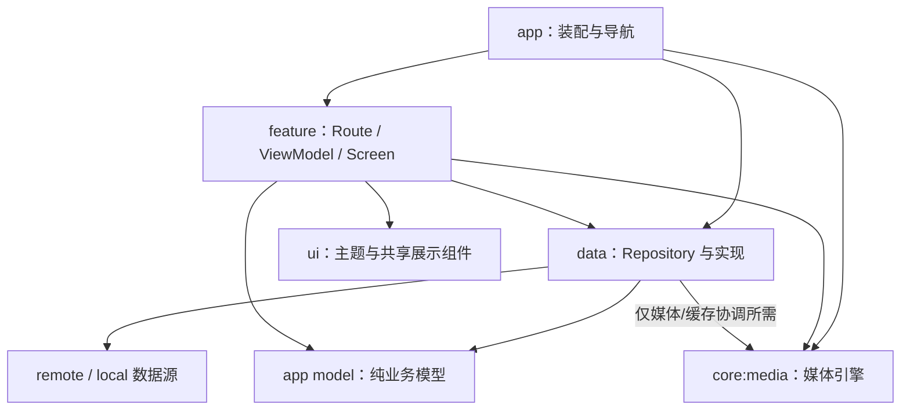

# VVideo 安卓目录与代码组织规范

版本：1.0.0。适用范围：本仓库的原生 Android 客户端。

本文是未来施工规则，不代表已存在 Gradle 工程或 APK。除标明“按需”的部分外，路径、职责和依赖方向为项目约定。目录树中的占位包名、示例类和可选模块不要求一次性创建。

本文与根 [AGENTS.md](AGENTS.md)、[目录规范.md](目录规范.md) 及 [项目目录决策](docs/decisions/2026-10-08-project-layout.md) 配合使用。产品行为与性能目标见 [docs/DESIGN.md](docs/DESIGN.md)。Android 的例外仅限已记录范围，不修改 Go 目录基线。

## 1. 参考与选择

已核实的开源参考：

- [Now in Android](https://github.com/android/nowinandroid) 及其 [模块化说明](https://github.com/android/nowinandroid/blob/main/docs/ModularizationLearningJourney.md)：参考按 feature / core 区分职责、应用负责装配、基础能力不反向依赖业务界面的原则。
- [Android Architecture Samples](https://github.com/android/architecture-samples)：参考单 Activity、Compose Screen 与 ViewModel、Flow / 协程、Repository 和可替换数据源的组织方式。
- [Android 架构建议](https://developer.android.com/topic/architecture/recommendations) 与 [模块化模式](https://developer.android.com/topic/modularization/patterns)：用于核对状态、依赖及模块边界。

以下结构是针对 VVideo 的项目决定，不是对这些仓库当前目录的逐项复制，也不是 Android 官方唯一推荐的目录树。第一版采用 Kotlin、Jetpack Compose、Media3；功能按包组织，媒体引擎单独隔离。不会照搬大型示例的全部模块、演示 flavor、构建插件和发布流程。

## 2. 工程根与模块

Android 工程根固定为 `android/`。Android Studio 打开该目录，Gradle 命令在该目录执行。根 Go 工程不放 Gradle 文件，Android 不直接引用 Go `internal/`。

生产模块先采用：

| Gradle 模块 | 路径 | 职责 |
| --- | --- | --- |
| `:app` | `android/app/` | 应用入口、导航、功能 UI、业务状态、仓库与依赖装配 |
| `:core:media` | `android/core/media/` | Media3 播放会话、媒体数据源、预加载和视频字节缓存 |

开始真实性能验收时才增加 `:benchmark`，路径为 `android/benchmark/`，用于 Macrobenchmark 和适用的 Baseline Profile 工作。不先创建空 benchmark 工程。

`core/` 是 Gradle 模块路径的父目录，不是单独的模块。功能包不是默认 Gradle 模块。未来只有独立依赖、构建耗时、复用或测试隔离出现实际需求时才拆分功能模块；拆分须记录决策并一次性更新路径，不保留双份实现。

### 2.1 预期结构

```text
android/
├── settings.gradle.kts          # 唯一的 Android 模块清单与仓库配置入口
├── build.gradle.kts             # 工程级插件声明和确有需要的公共配置
├── gradle.properties            # 可共享的构建参数，不含本机路径与密钥
├── gradlew
├── gradlew.bat
├── gradle/
│   ├── libs.versions.toml       # 依赖和插件版本目录
│   └── wrapper/                # Wrapper 配置及其所需文件
├── app/
│   ├── build.gradle.kts
│   ├── proguard-rules.pro      # 仅实际需要的规则
│   └── src/
│       ├── main/
│       │   ├── AndroidManifest.xml
│       │   ├── kotlin/<basePackagePath>/
│       │   │   ├── app/        # Application、Activity、导航和 DI 装配
│       │   │   ├── feature/    # library、player、settings
│       │   │   ├── data/       # Repository、API、本地状态和映射
│       │   │   ├── model/      # 跨功能使用的纯业务模型
│       │   │   └── ui/         # 主题和真实跨功能复用的展示组件
│       │   └── res/
│       │       ├── values/    # 字符串与适用资源值
│       │       ├── drawable/  # 图片/矢量资源，按需
│       │       └── xml/       # 实际使用的网络、备份等平台配置
│       ├── test/kotlin/<basePackagePath>/
│       ├── androidTest/kotlin/<basePackagePath>/
│       └── debug/             # 仅确需 debug Manifest / 资源时创建
├── core/media/
│   ├── build.gradle.kts
│   └── src/
│       ├── main/
│       │   ├── AndroidManifest.xml  # 仅模块确有声明需要时创建
│       │   └── kotlin/<basePackagePath>/core/media/
│       │       ├── model/      # 播放所需最小输入/输出模型
│       │       ├── playback/   # 播放会话与生命周期
│       │       ├── preload/    # 邻近窗口、优先级与取消
│       │       ├── cache/      # 视频缓存实例、限额与安全清理
│       │       └── datasource/# Range 字节读取、缓存键和请求配置
│       ├── test/kotlin/<basePackagePath>/core/media/
│       └── androidTest/kotlin/<basePackagePath>/core/media/
└── benchmark/                  # 实际开始性能测试时创建的测试模块
```

`<basePackagePath>` 表示正式包名对应路径，不能原样创建。首次脚手架时确定开发 namespace / applicationId 并写入真实 Gradle 配置；发布标识和签名未确定前不声称已经可发布。模块 namespace 与包职责一致。

### 2.2 构建与本地文件

- Kotlin DSL 为唯一的 Gradle 配置形式，不混建同一职责的 Groovy 文件。
- 创建工程时核实 Kotlin、AGP、Gradle、JDK、Compose、Media3 的兼容组合，并固定在真实工具配置中。SDK / JDK 版本来源写入 README，不用猜测的“最新版本”。
- 提交可复现构建所需的 Gradle Wrapper 文件、版本目录及实际采用的依赖校验/锁定文件；不手写虚假 Wrapper 或空锁文件。
- `local.properties` 中的本机 SDK 路径、签名文件与密码不得提交。凭据和真实 NAS 地址不能进入示例源码或预览 fixture。
- 忽略本地 `.gradle/`、`.kotlin/`、各模块 `build/`、APK/AAB 输出和临时性能报告。需要共享的 IDE 配置另行明确，不把个人 IDE 状态整包提交。
- 所有构建输出以真实 Gradle 配置为准，不为了满足目录外观复制到另一份源码树。
- 初期不引入 `buildSrc/`、`build-logic/`、多个空 core 模块或仅转发 Gradle 的统一命令层。出现重复构建逻辑后再决定是否引入约定插件。

## 3. 功能代码的唯一归属

以下路径均相对 `app/src/main/kotlin/<basePackagePath>/`。

| 路径 | 内容 | 不应承担的职责 |
| --- | --- | --- |
| `app/` | `VVideoApplication`、`MainActivity`、根 Compose 内容、依赖生命周期 | 目录扫描规则、网络协议解析、播放缓冲策略 |
| `app/navigation/` | 路由声明、跨功能导航组合、返回栈 | 复制页面实现或跨功能传递 ViewModel / Player 实例 |
| `app/di/` | 注入绑定和构造装配 | 服务定位器式全局可变业务状态 |
| `feature/library/` | 目录浏览、右上角排序菜单、十媒体相册、分页 UI 与定位恢复 | HTTP 客户端、视频字节缓存 |
| `feature/library/album/` | 组内布局计算、宽高比/裁切规则、布局模型 | 请求网络、读磁盘、直接创建播放器 |
| `feature/player/` | 全屏视频流、播放控件、画面挂载及图片查看入口 | 自行新建第二套媒体引擎或缓存管理器 |
| `feature/settings/` | 服务连接与缓存设置页面、状态和交互 | 在 Composable 中直接清理文件或持有数据库连接 |
| `data/library/` | 媒体目录 Repository、全局排序分页、锚点定位和版本更新规则 | 引用 UI、Activity 或 feature ViewModel |
| `data/library/remote/` | API 定义、DTO、错误转换与协议映射 | 把 API DTO 当作可随意修改的页面状态 |
| `data/library/local/` | Room 实体、DAO、各目录排序/浏览锚点及确有需求的本地历史/索引 | 镜像整份 NAS 媒体数据以代替分页 |
| `data/settings/` | DataStore 偏好、连接资料、最近浏览入口和设置 Repository | 明文硬编码密钥、依赖设置页面 |
| `data/cache/` | 协调视频与图片缓存的总预算、统计和清理流程 | 复制 `:core:media` 的视频缓存实现 |
| `model/` | 媒体 ID、目录项等已被多个功能使用的纯模型 | Android UI 类型、网络注解、数据库实体 |
| `ui/theme/` | 颜色、字体、间距及主题 token | 页面的业务状态 |
| `ui/component/` | 实际跨功能复用的展示组件 | 单个 feature 专属组件和数据访问 |

某功能独有的 UI、模型、辅助计算和组件就近放置；不能先放到公共目录再寻找使用方。禁止新增职责不明的 `common/`、`utils/`、`helpers/`、`misc/`，也不并建 `screens/`、`pages/`、`views/` 来保存同一批页面。

图片查看可与视频流共用当前目录上下文，但图片缩放与视频上下翻页的手势须分别定义。未确定的产品交互记录在设计文档，不依靠目录命名暗中决定。

## 4. 依赖与状态方向



- `:app` 可以依赖 `:core:media`；后者不得反向依赖 `:app` 的模型、Repository、DI、导航或页面。
- 媒体模块输入使用其自有的最小 `PlaybackItem` 等类型，由 `:app` 在边界完成映射。不把服务端 DTO 或 Room Entity 传进媒体引擎。
- `data/`、纯模型和 `ui/` 公共展示组件不得导入 `feature/` 或应用装配；页面专属 UI 模型留在 feature 中。
- 跨 feature 通过导航参数（媒体 ID、目录 ID、排序/游标等）与明确状态契约协作，不能直接调用另一功能的私有文件或共用其 ViewModel。
- Repository 统一数据访问；UI 不直接调用 HTTP、DAO 或文件系统。复杂且确有复用的业务操作可以增加所属领域的用例，不为每个简单方法强行增加 UseCase 层。
- `*Route` 负责获取 ViewModel、生命周期感知地收集状态和连接导航；`*Screen` 接受不可变 `UiState` 与事件回调，能够在预览和测试中独立渲染。
- ViewModel 暴露只读 `StateFlow`，内部修改状态。业务请求走协程，耗时工作明确调度和取消；不要在重组时启动重复请求。
- 不在 ViewModel 中持有 Activity、View、Surface 或 Activity Context。播放器会话由明确生命周期的拥有者管理，ViewModel 与它交换状态和命令。
- Media3 的线程与生命周期规则同样适用：不以“全部移到 IO 线程”为理由从错误线程调用播放器。

单模块内的包边界不能靠 Gradle 自动保证，因此代码审查必须检查 import 和依赖方向；不能仅凭目录树声称隔离已实现。

## 5. 命名、资源与布局

- 功能包使用单数 `feature/`，业务包固定 `library`、`player`、`settings`。Kotlin 包名全小写，不使用连字符；文件名采用职责明确的 PascalCase。
- 页面常用命名为 `LibraryRoute.kt`、`LibraryScreen.kt`、`LibraryViewModel.kt`、`LibraryUiState.kt`；仅创建实际需要的文件，不强制一类一目录。
- 布局计算使用明确名称，例如 `AlbumLayoutCalculator.kt`；网络类型采用 `*Dto`、持久实体采用 `*Entity`，边界映射明确，避免一个超大 `Models.kt`。
- UI 优先使用 Compose。主题位于 `ui/theme/`，业务布局位于 feature。仅需要平台或 View 互操作时使用 XML 布局，不预建空 `res/layout/`。
- 用户可见文本放字符串资源；debug 占位文案和模拟媒体不得混入正式功能。资源使用 Android 命名规则，图片资源按显示需求控制大小。
- 单个相册组的布局先根据元信息宽高比计算，考虑旋转和最后不足十项的情况。图片载入不能引起整组反复跳动。
- Compose 列表使用稳定媒体键、分页和可见区域加载。布局缓存的键包含数据版本、容器宽度和影响布局的参数，方向或尺寸变化时正确失效。
- 分页仓库和布局缓存同样限制驻留数量，支持释放远处页面及按锚点/双向游标恢复；不能只懒渲染却无限保存已读元信息。图片请求尺寸与展示尺寸匹配，取消不再需要的离屏工作。
- 不在手指滑动的每一帧重排整个目录；只在尺寸或输入数据变化时重新计算相关组。
- 播放进度、缓冲状态等高频变化仅由相关控件订阅，避免整个目录或全部播放页持续重组。先用实际 trace 定位性能问题；框架、语言或目录分层本身不构成流畅性保证。
- 按 [当前设计](docs/DESIGN.md) 支持系统允许的高刷，不设置固定帧率上限。滚动与动画跟随平台帧时钟；UI / 窗口高刷请求由界面生命周期管理，媒体引擎负责真实视频帧率信息，二者协调而不混用。具体 API 必须核对目标版本及设备支持。
- 目录排序与重开位置按 [当前设计](docs/DESIGN.md) 执行。排序交给服务端覆盖完整结果集；浏览锚点使用稳定媒体 ID 和视口偏移，不能只保存页码或百分比。
- 各目录浏览状态节流持久化，冷启动从锚点附近分页恢复；不要把整个媒体列表塞入 `SavedStateHandle`，也不能仅依赖 `rememberSaveable` 处理用户退出重开。
- 布局恢复只在必要时执行，避免重组或迟到的分页响应覆盖用户新滚动位置。读盘失败、目录离线或恢复尚未完成时不能将初始零位置反写为有效书签。
- 全屏播放保持源视频比例；封面到首帧的交接与实际渲染事件关联，不能靠固定延时假装首帧已出现。
- 触控目标、系统边衬、字体缩放、横竖屏和返回操作都需验证；主流程不能依赖只能悬停触发的交互。

## 6. 媒体模块与缓存职责

| `core/media` 内部包 | 唯一职责 |
| --- | --- |
| `playback/` | 播放会话、Player 生命周期、当前媒体状态及受控释放 |
| `preload/` | 当前项附近的预取窗口、优先级、取消、预算协调 |
| `cache/` | 应用级视频 SimpleCache、磁盘占用、缓存淘汰和安全清理 |
| `datasource/` | Media3 数据源配置、HTTP Range、认证头注入、媒体版本缓存键 |
| `model/` | 独立于 app 的最小播放请求和状态类型 |

具体预取范围、容量选项、单位和清理行为遵循 [当前设计](docs/DESIGN.md)，不在本规范再维护一套数值。

必须遵守：

1. UI 可以消费受控的播放器接口以挂载画面，但不能在卡片、分页或每次重组中自行构造 ExoPlayer。
2. 当前播放和拖动请求优先；快速切换取消过时预取。共用缓存键与读取链路，避免播放器和预加载重复请求同一范围。
3. 磁盘缓存、内存样本缓冲、图片解码缓存分别管理。DataStore 保存设置，视频字节缓存保存可回收数据；不能混放。
4. 视频 SimpleCache 对同一目录只有一个活动实例。切换预算、清理缓存和释放播放器协调执行；清理时处理对应索引，不能仅删目录或改占用数字。
5. 总媒体缓存预算由 `app/data/cache/` 协调视频缓存与图片加载库缓存；两者不能各自重复使用整个用户上限。
6. 文件版本改变时旧元信息、Range 范围和缓存一并失效；`moov` 缓存必须保持原字节偏移，不能把脱离容器的普通 JSON 当成播放器索引。
7. 不能由 UI 通过缓存设置绕过解码能力限制。设备不支持的视频明确展示错误，不在后台偷偷转码。

## 7. 测试、fixture 与性能报告

- JVM 测试放被测模块的 `src/test/kotlin/`；包路径与被测代码对应，文件名为 `*Test.kt`。布局算法、窗口调度、状态变化和版本/缓存键规则优先做不依赖真机的测试。
- 设备/模拟器测试放该模块 `src/androidTest/kotlin/`，覆盖 Android 存储、生命周期、Compose 交互以及真实媒体管线等需要平台的行为。
- 固定数据放相应 source set 的 `resources/` 或 `assets/`，仅实际需要时创建；跨测试复用须有真实使用方，不先建立空共享测试模块。
- 测试媒体使用小型合成文件或来源、使用权明确的样本。记录生成方式及预期特征，禁止从用户库随手复制原视频、路径或凭据进入仓库。
- 测试需覆盖最后不足十项、极端宽高比、分页更新定位、快速正反滑、预加载取消、版本变化、缓存限额降低、清理/播放竞争以及网络中断。
- 对排序与浏览恢复额外覆盖时间字段回退及同值稳定序、用户退出后冷启动、服务端离线保留书签、媒体增删后锚点回退、旋转重排、清理缓存保留记录，以及无需从第一页遍历的大目录恢复。
- 使用实际工具生成和管理截图基线；更新基线前检查变化是否符合需求。临时失败截图、trace 和性能报告保留在被忽略的构建输出中，不混入 `res/` 或 fixture。
- 性能测试针对 release/profileable 构建。记录机型、系统、刷新率、构建标识、缓存状态、媒体特征和网络条件；UI 帧表现与视频首帧时间分开计量。
- 高刷为主要验收条件，低刷仅测兼容；同时采集实际屏幕刷新率和 UI 呈现节奏，覆盖手指离开后的惯性滑动、视频播放中的交互及前后台恢复。用户打开系统高刷设置不等于本应用已达到目标，不用屏幕刷新率数字替代帧表现证据。
- 执行 [当前设计](docs/DESIGN.md) 的性能门槛，分别验证暖缓存、冷加载、快速连滑、大目录和长期使用。内存包含 native/图形及进程占用，不能只看 Java/Kotlin 堆；磁盘缓存、安装体积与 RAM 分别报告。
- 列表、布局、图片、播放器或预取改动须复测受影响场景并比较冻结基线；未通过不能以功能已完成为由宣称交付达标。数值门槛仅维护在设计文档，避免两套验收标准。
- iQOO 12 Pro 为首个目标设备。未连接真机或缺少样本时明确写未验证，不能把纯布局预览的表现当作原画视频实测。

## 8. 工程初始化后的检查入口

当前尚无 Gradle Wrapper，以下为未来工程采用对应模块与默认 debug 变体后的候选命令，**本次不声称这些命令已可运行或已通过**。初始化时必须用真实任务清单确认并更新两个 README。

```sh
cd android
./gradlew tasks --all
./gradlew :app:assembleDebug :app:lintDebug :app:testDebugUnitTest
./gradlew :core:media:lintDebug :core:media:testDebugUnitTest
```

有对应设备测试和可用设备时，再运行实际存在的 `connectedDebugAndroidTest` 任务。性能模块的任务名称来自真实配置，不猜测发布变体或签名条件。格式化工具在首次采用时固定版本与真实调用方式，不因本规范存在就伪造 ktlint / detekt 的执行结果。

所有可执行代码变更在适用验证后，按根 [AGENTS.md](AGENTS.md) 使用 `open-code-review` 复核；测试通过不能替代依赖边界、生命周期和性能风险检查。

## 9. 施工检查表

- [ ] Android 文件位于唯一的 `android/` 工程，模块清单与实际源码一致。
- [ ] 新目录有实际职责和内容，无空模块、重复源集或第二套页面目录。
- [ ] feature、data、ui、媒体引擎的依赖方向正确，无跨功能私有导入。
- [ ] Screen 可通过状态与回调独立渲染，网络和文件操作不在 Composable 中。
- [ ] 播放器、预加载和缓存有明确拥有者、线程、取消和释放规则。
- [ ] 源码、资源、测试、报告、设备运行数据和个人配置没有混放。
- [ ] 修改对应的测试和文档，实际执行所需检查，列明未执行条件。
- [ ] 使用 `open-code-review` 完成代码审查或明确记录工具阻碍；未将部分成功说成全量通过。

规则调整应同步本文、项目目录决策和受影响的 README；不能通过保留旧模块来长期兼容两套施工规范。
